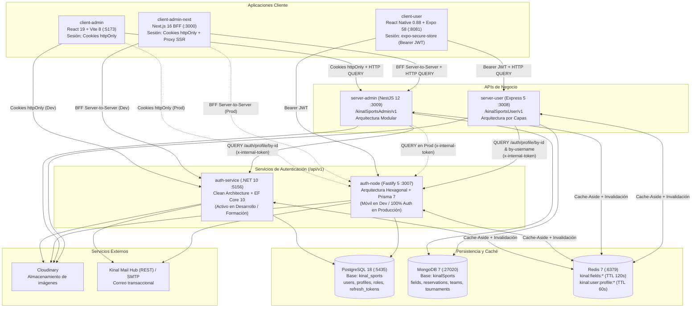

# KinalSports — Monorepo de Microservicios y Aplicaciones Cliente

## 1. Identificación del Proyecto

**KinalSports** es una plataforma de gestión administrativa y reserva de instalaciones deportivas construida bajo una arquitectura de microservicios poliglota dentro de un monorepo.

- **Contexto institucional y formativo:** Proyecto desarrollado en el marco formativo de **Fundación Kinal** (Centro Educativo Técnico Laboral Kinal, Guatemala), orientado a los programas técnicos de informática (`IN6AM` / `IN6AV`).
- **Propósito técnico y educativo:** Demostrar cómo integrar distintos lenguajes, frameworks, motores de bases de datos y patrones arquitectónicos (_Hexagonal Architecture_, _Clean Architecture_, _Modular Architecture_, _Layered Architecture_, _Single Page Application_ y _Backend for Frontend_) en un ecosistema funcional, mantenible y verificable mediante pruebas automatizadas.
- **Repositorio remoto:** `https://github.com/6toInformatica/mono_repo_kinalSports.git`
- **Rama principal:** `master`

---

## Tabla de Contenidos

1. [Identificación del Proyecto](#1-identificación-del-proyecto)
2. [Descripción Funcional](#2-descripción-funcional)
3. [Arquitectura del Sistema](#3-arquitectura-del-sistema)
4. [Estructura del Repositorio](#4-estructura-del-repositorio)
5. [Requisitos Previos](#5-requisitos-previos)
6. [Quick Start (Guía de Inicio Rápido)](#6-quick-start-guía-de-inicio-rápido)
7. [Configuración de Variables de Entorno](#7-configuración-de-variables-de-entorno)
8. [Pruebas Automatizadas y Calidad de Código](#8-pruebas-automatizadas-y-calidad-de-código)
9. [Navegación y Documentación del Monorepo](#9-navegación-y-documentación-del-monorepo)
10. [Autoría, Responsabilidad Técnica y Contexto Institucional](#10-autoría-responsabilidad-técnica-y-contexto-institucional)

---

## 2. Descripción Funcional

KinalSports resuelve la operación diaria de un complejo deportivo separando las responsabilidades administrativas de las operaciones de los usuarios finales:

- **Identidad, autenticación y control de acceso:** Registro de usuarios con carga de fotografía, verificación de correo electrónico, recuperación de contraseña, emisión de JWT (`HS256`) con rotación de _refresh tokens_ y control de acceso basado en roles (`ADMIN_ROLE` y `USER_ROLE`).
- **Catálogo de canchas deportivas (`fields`):** Administración del inventario de canchas (tipo de superficie, capacidad `FUTBOL_5` / `FUTBOL_7` / `FUTBOL_11`, tarifa por hora, estado activo/inactivo e fotografía en Cloudinary) y consulta filtrada por criterios.
- **Gestión de reservaciones (`reservations`):** Consulta de disponibilidad horaria en la zona `America/Guatemala` (`06:00` a `22:00`), creación de reservas de 1 a 3 horas por parte de los jugadores, e interfaz administrativa para confirmar o cancelar reservaciones.
- **Equipos deportivos (`teams`):** Creación de equipos con logotipo, asignación de capitán (_manager_), incorporación de miembros registrados (mediante `username`) o invitados nombrados, y control de cupos máximos por categoría (`12` en `FUTBOL_7`, `18` en `FUTBOL_11`).
- **Torneos (`tournaments`):** Creación y publicación de torneos por categoría deportiva, control de estados (`PENDIENTE`, `EN_CURSO`, `FINALIZADO`, `CANCELADO`) e inscripción de equipos activos por parte de sus capitanes.

---

## 3. Arquitectura del Sistema

### 3.1 Diagrama de Arquitectura y Comunicación



### 3.2 Componentes del Monorepo y Stack Verificado

| Componente          | Tecnología Verificada en Código                                                           | Patrón Arquitectónico                                                                | Base de Datos / Estado                      | Puerto                                |
| :------------------ | :---------------------------------------------------------------------------------------- | :----------------------------------------------------------------------------------- | :------------------------------------------ | :------------------------------------ |
| `auth-node`         | Node.js `>=22.13` (`node:26-slim` en Docker), Fastify 5, TypeScript 6, Prisma 7, Argon2id | Arquitectura Hexagonal (Puertos y Adaptadores)                                       | PostgreSQL 18 + Redis 7                     | `3007`                                |
| `auth-service`      | .NET 10 (`net10.0`, C# 14), ASP.NET Core 10, EF Core 10 (`Npgsql`), Argon2id              | Clean Architecture (`Domain`, `Application`, `Infrastructure`, `Persistence`, `Api`) | PostgreSQL 18 + Redis 7                     | `5156`                                |
| `server-admin`      | Node.js `>=22.13`, NestJS 12, TypeScript 6, Mongoose 9, Zod 4                             | Arquitectura Modular (NestJS Modules, Guards, Pipes, Interceptors)                   | MongoDB 7 + Redis 7                         | `3009`                                |
| `server-user`       | Node.js `>=22.13` (ESM), Express 5, Mongoose 9, `express-validator`                       | Arquitectura por Capas (`routes` -> `controller` -> `service` -> `repository`)       | MongoDB 7 + Redis 7                         | `3008`                                |
| `client-admin`      | React 19.3, Vite 8, TailwindCSS 4, React Router 7, Zustand 5, Axios                       | SPA organizada por _features_ (`src/features/*`, `src/shared/*`)                     | Cookies `httpOnly` + Zustand (`partialize`) | `5173` (`8080` interno en Nginx Prod) |
| `client-admin-next` | Next.js 16.4 (App Router), React 19.3, TypeScript 6, TailwindCSS 4                        | Backend for Frontend (BFF) con Route Handlers y `src/proxy.ts`                       | Cookies `httpOnly` en servidor              | `3000`                                |
| `client-user`       | React Native 0.88.1, Expo SDK 58, React Navigation 7, Zustand 5                           | Aplicación móvil por _features_ con almacenamiento nativo seguro                     | `expo-secure-store`                         | `8081` (Metro)                        |

### 3.3 Diferencias Reales entre Desarrollo (`docker-compose.yml`) y Producción (`docker-compose.prod.yml`)

| Aspecto                                      | Entorno de Desarrollo (`docker-compose.yml`)                                                                           | Entorno de Producción (`docker-compose.prod.yml`)                                                                                                             |
| :------------------------------------------- | :--------------------------------------------------------------------------------------------------------------------- | :------------------------------------------------------------------------------------------------------------------------------------------------------------ |
| **Servicios de autenticación activos**       | Se ejecutan simultáneamente `auth-service` (.NET 10, `:5156`) y `auth-node` (Fastify, `:3007`).                        | Se ejecuta **únicamente `auth-node` (`:3007`)**. No se levanta ningún contenedor de `.NET`.                                                                   |
| **Inicialización del esquema PostgreSQL**    | El contenedor efímero `auth-migrator` aplica las migraciones de EF Core antes de iniciar `auth-service` y `auth-node`. | `auth-node` verifica e inicializa de forma idempotente el esquema SQL canónico, los roles (`ADMIN_ROLE`, `USER_ROLE`) y el administrador inicial al arrancar. |
| **Autenticación del stack administrativo**   | `client-admin`, `client-admin-next` y `server-admin` apuntan a `auth-service` (`:5156`).                               | `client-admin`, `client-admin-next` y `server-admin` apuntan a `auth-node` (`:3007`).                                                                         |
| **Autenticación del stack móvil/usuario**    | `client-user` y `server-user` apuntan a `auth-node` (`:3007`).                                                         | `server-user` apunta a `auth-node` (`:3007`). (`client-user` no se despliega como contenedor en producción).                                                  |
| **Etapas de construcción Docker (`target`)** | Etapa `dev` con código montado por volumen y recarga en caliente (`nodemon`, `dotnet watch`, `vite`, `next dev`).      | Etapa `runtime` compilada y ejecutada con usuarios sin privilegios (`USER node`, `$APP_UID` y `nginxinc/nginx-unprivileged:1.27-alpine`).                     |
| **Secretos de infraestructura**              | Variables con valores por defecto de desarrollo en `docker-compose.yml`.                                               | `POSTGRES_USER`, `POSTGRES_PASSWORD`, `JWT_SECRET` e `INTERNAL_SERVICE_TOKEN` son obligatorios (`:?Define ... en .env.docker`).                               |

### 3.4 Comunicación entre Componentes, Seguridad de Sesión y Caché

1. **Interoperabilidad criptográfica en autenticación:** `auth-node` y `auth-service` operan sobre las mismas tablas de PostgreSQL 18 (`users`, `user_profiles`, `roles`, `user_roles`, `user_emails`, `user_password_resets`, `refresh_tokens`), emplean los mismos parámetros de Argon2id y firman tokens JWT `HS256` con idénticos `SecretKey`, `Issuer` (`AuthService`) y `Audience` (`AuthService`).
2. **Almacenamiento seguro de sesión según plataforma:**
   - **Web (`client-admin` y `client-admin-next`):** Ninguno de los dos clientes web almacena tokens JWT ni _refresh tokens_ en `localStorage` o `sessionStorage`. La sesión viaja en cookies `httpOnly` (`kinal_access` con vigencia de 15 min y `kinal_refresh` de 30 días, `SameSite=Lax`, `Secure` en producción).
   - **Móvil (`client-user`):** Utiliza el almacenamiento cifrado del sistema operativo móvil mediante `expo-secure-store` y envía el token en la cabecera `Authorization: Bearer <token>`.
3. **Consultas seguras con cuerpo mediante el método HTTP `QUERY`:**
   - Comunicación interna entre microservicios: `server-admin` y `server-user` resuelven perfiles de usuario invocando `QUERY /api/v1/auth/profile/by-id` y `QUERY /api/v1/auth/profile/by-username` autenticados con la cabecera `x-internal-token` (conservando `POST` como alias compatible).
   - Filtrado de canchas: `server-admin` (`QUERY /kinalSportsAdmin/v1/fields`), `server-user` (`QUERY /kinalSportsUser/v1/fields`) y el proxy BFF de `client-admin-next` aceptan filtros estructurados (`fieldType`, `capacity`, `maxPricePerHour`, `search`, `isActive`, `page`, `limit`) en el cuerpo JSON de una petición `QUERY`.
4. **Caché distribuida `Cache-Aside` en Redis 7 con degradación en memoria:**
   - Los cuatro servicios backend implementan un cliente Redis sobre protocolo TCP `RESP2` que degrada automáticamente a un diccionario en memoria local si `REDIS_URL` no está definido o si Redis no responde.
   - Claves compartidas: `kinal:fields:*` (TTL 120 s, invalidada por `server-admin` al crear, editar o cambiar el estado de una cancha) y `kinal:user:profile:<userId>` (TTL 60 s, invalidada al cambiar avatar, verificar correo o modificar el rol de un usuario).

---

## 4. Estructura del Repositorio

```text
kinalSports/
├── authentication-service/
│   ├── auth-node/              # Microservicio de autenticación en Node.js + Fastify + Prisma
│   └── auth-service/           # Microservicio de autenticación en .NET 10 + EF Core (Clean Architecture)
├── server-admin/               # API administrativa en NestJS 12 + Mongoose
├── server-user/                # API de operaciones de usuario en Express 5 + Mongoose
├── client-admin/               # Panel administrativo SPA en React 19 + Vite 8
├── client-admin-next/          # Panel administrativo BFF en Next.js 16 (App Router)
├── client-user/                # Aplicación móvil en React Native 0.88 + Expo SDK 58
├── tests/
│   └── contract/               # Pruebas de contrato HTTP de caja negra (Vitest + Mailpit)
├── scripts/
│   └── seed/                   # Script de carga y reinicio de datos iniciales en contenedores Docker
├── dockerfiles/                # Dockerfiles multi-stage por componente (dev, runtime, migrator)
├── .github/                    # Plantillas de Pull Request y reporte de Issues
├── .husky/                     # Git hooks (pre-commit, commit-msg, pre-push)
├── docker-compose.yml          # Orquestación de desarrollo (.NET 10 + Node.js + Postgres + Mongo + Redis)
├── docker-compose.prod.yml     # Orquestación de producción (100% Node.js + Postgres + Mongo + Redis)
├── package.json                # Scripts globales y configuración de lint-staged / Commitizen
└── pnpm-workspace.yaml         # Definición de workspaces, allowBuilds y overrides de seguridad
```

---

## 5. Requisitos Previos

- **Node.js:** `>= 22.13.0` (requerido en `package.json`; `.nvmrc` sugiere Node `24` para desarrollo local y los `Dockerfile.*` utilizan `node:26-slim`).
- **pnpm:** `>= 10` (el repositorio fija `packageManager: pnpm@10.29.2`).
- **.NET SDK:** `10.0.x` (`global.json` define `10.0.100` con `rollForward: latestFeature`). Requerido para compilar y probar `auth-service` y para el hook `.husky/pre-commit` (`dotnet format`). No se requiere en el servidor donde se despliegue `docker-compose.prod.yml`.
- **Docker y Docker Compose:** Requeridos para ejecutar el stack contenerizado, el sembrado de datos (`pnpm db:seed`) y las pruebas de contrato (`pnpm test:contract`).
- **Motores de datos (si se ejecuta sin Docker):** PostgreSQL `18`, MongoDB `7+` y opcionalmente Redis `7+`.

---

## 6. Quick Start (Guía de Inicio Rápido)

### 6.1 Instalación inicial del monorepo

```bash
git clone https://github.com/6toInformatica/mono_repo_kinalSports.git
cd mono_repo_kinalSports
pnpm install
```

### 6.2 Ejecución mediante Docker (Entorno de Desarrollo)

Levanta PostgreSQL 18 (`:5435`), MongoDB 7 (`:27020`), Redis 7 (`:6379`), `auth-migrator`, `auth-service` (`:5156`), `auth-node` (`:3007`), `server-admin` (`:3009`), `server-user` (`:3008`), `client-admin` (`:5173`), `client-admin-next` (`:3000`) y `client-user` (`:8081`):

```bash
# Levantar en segundo plano reconstruyendo imágenes y volúmenes anónimos
pnpm docker:up:detached

# Cargar datos de prueba (requiere los contenedores de docker-compose.yml en estado healthy)
pnpm db:seed

# Consultar logs en tiempo real
pnpm docker:logs

# Detener el entorno
pnpm docker:down
```

> **Nota sobre `pnpm db:seed` y `pnpm db:reset`:** El script `scripts/seed/seed.mjs` ejecuta comandos `docker exec` sobre los contenedores `pg-kinal-sports`, `kinal_mongodb`, `kinal_server_admin` y `kinal_auth_service`. Por ello, requiere que el stack de desarrollo (`docker-compose.yml`) esté en ejecución.

### 6.3 Ejecución mediante Docker (Entorno de Producción — 100% Node.js)

Requiere definir previamente el archivo `.env.docker` en la raíz con las variables obligatorias (`POSTGRES_USER`, `POSTGRES_PASSWORD`, `JWT_SECRET`, `INTERNAL_SERVICE_TOKEN`):

```bash
pnpm docker:prod:up
pnpm docker:prod:logs
pnpm docker:prod:down
```

### 6.4 Ejecución en Desarrollo Local (Sin Docker)

Con instancias locales de PostgreSQL (`:5435`), MongoDB (`:27020`) y opcionalmente Redis (`:6379`), configura los archivos de entorno de cada componente (sección 7) y ejecuta en terminales separadas:

```bash
pnpm --filter auth-service dev            # http://localhost:5156
pnpm --filter auth-node dev               # http://localhost:3007
pnpm --filter server-admin dev            # http://localhost:3009
pnpm --filter server-user dev             # http://localhost:3008
pnpm --filter @kinal/client-admin dev     # http://localhost:5173
pnpm --filter @kinal/client-admin-next dev # http://localhost:3000
pnpm --filter client-user start           # Metro Bundler en puerto 8081
```

---

## 7. Configuración de Variables de Entorno

Ningún archivo `.env` ni `.env.docker` debe subirse al control de versiones. Cada paquete incluye su propia plantilla:

| Componente                  | Plantilla en el Repositorio                                                                    | Archivo Local Destino                                                                  | Notas de Configuración                                                                                                                                     |
| :-------------------------- | :--------------------------------------------------------------------------------------------- | :------------------------------------------------------------------------------------- | :--------------------------------------------------------------------------------------------------------------------------------------------------------- |
| **Docker (`dev` / `prod`)** | _(Crear manualmente en raíz)_                                                                  | `.env.docker`                                                                          | Opcional en `docker-compose.yml`; obligatorio en `docker-compose.prod.yml` (`POSTGRES_USER`, `POSTGRES_PASSWORD`, `JWT_SECRET`, `INTERNAL_SERVICE_TOKEN`). |
| `auth-node`                 | `authentication-service/auth-node/.env.example`                                                | `authentication-service/auth-node/.env`                                                | Configurar `DB_*`, `JWT_SECRET` (mínimo 32 caracteres), `INTERNAL_SERVICE_TOKEN`, `REDIS_URL`.                                                             |
| `auth-service`              | `authentication-service/auth-service/src/AuthService.Api/appsettings.Development.example.json` | `authentication-service/auth-service/src/AuthService.Api/appsettings.Development.json` | Ajustar `Port=5435`, `Database=kinal_sports` y `InternalServiceToken` para coincidir con el resto del monorepo.                                            |
| `server-admin`              | `server-admin/.env.example`                                                                    | `server-admin/.env`                                                                    | `URI_MONGODB`, `JWT_SECRET`, `AUTH_SERVICE_URL` (`:5156` o `:3007`), `INTERNAL_SERVICE_TOKEN`, `REDIS_URL`.                                                |
| `server-user`               | `server-user/.env.example`                                                                     | `server-user/.env`                                                                     | `URI_MONGODB`, `JWT_SECRET`, `ADMIN_SERVICE_URL`, `AUTH_NODE_URL`, `INTERNAL_SERVICE_TOKEN`, `REDIS_URL`.                                                  |
| `client-admin`              | `client-admin/.env.example`                                                                    | `client-admin/.env`                                                                    | `VITE_AUTH_URL`, `VITE_ADMIN_URL`, `VITE_CLOUDINARY_BASE_URL`.                                                                                             |
| `client-admin-next`         | `client-admin-next/.env.example`                                                               | `client-admin-next/.env.local`                                                         | `AUTH_API_URL` y `ADMIN_API_URL` (exclusivas del servidor Next.js) y `NEXT_PUBLIC_CLOUDINARY_BASE_URL`.                                                    |
| `client-user`               | `client-user/.env.example`                                                                     | `client-user/.env`                                                                     | `EXPO_PUBLIC_AUTH_URL` y `EXPO_PUBLIC_USER_URL` (`10.0.2.2` en emulador Android o IP LAN en dispositivo físico).                                           |

> **Consistencia de secretos entre servicios:** `JWT_SECRET`, `JWT_ISSUER` (`AuthService`), `JWT_AUDIENCE` (`AuthService`) e `INTERNAL_SERVICE_TOKEN` deben ser idénticos en `auth-node`, `auth-service`, `server-admin` y `server-user`.

---

## 8. Pruebas Automatizadas y Calidad de Código

### 8.1 Comandos Globales Verificados (`package.json`)

```bash
# Ejecutar todas las pruebas unitarias del monorepo (Node.js + .NET 10, sin requerir Docker)
pnpm test

# Ejecutar ESLint en server-admin, server-user, auth-node, client-admin y client-admin-next
pnpm lint

# Formatear código en server-admin y server-user con Prettier
pnpm format

# Compilar todos los paquetes que definen script "build"
pnpm -r --if-present build

# Asistente interactivo de commits convencionales (Commitizen)
pnpm commit
```

### 8.2 Cobertura de Pruebas Unitarias por Componente

| Componente          | Runner de Pruebas          | Comando Individual                            | Alcance                                                                                                             |
| :------------------ | :------------------------- | :-------------------------------------------- | :------------------------------------------------------------------------------------------------------------------ |
| `auth-node`         | Vitest 5                   | `pnpm --filter auth-node test`                | Casos de uso de autenticación, adaptador Kinal Mail Hub, caché Redis y utilidades HTTP.                             |
| `auth-service`      | xUnit v3 (`dotnet test`)   | `pnpm --filter auth-service test`             | `AuthService.Application.Tests` y `AuthService.Infrastructure.Tests` (JWT, Argon2id, `RedisCacheService`, KMH).     |
| `server-admin`      | Vitest 5 + SWC             | `pnpm --filter server-admin test`             | Guards, `TokenService` (headers y cookies), `RedisCacheService`, servicios de canchas, reservas, equipos y torneos. |
| `server-user`       | Vitest 5                   | `pnpm --filter server-user test`              | Middleware JWT, `redis.cache`, reglas de negocio de reservas, equipos, torneos y perfiles.                          |
| `client-admin`      | Vitest 5 + Testing Library | `pnpm --filter @kinal/client-admin test`      | Renovación de sesión (`sessionRefresh`), formularios de autenticación y rutas protegidas.                           |
| `client-admin-next` | Vitest 5 + Testing Library | `pnpm --filter @kinal/client-admin-next test` | Middleware `proxy.ts`, verificación de rol en sesión, proxy BFF y vistas de autenticación.                          |
| `client-user`       | Jest 30 + `jest-expo`      | `pnpm --filter client-user test`              | `authStore` con `expo-secure-store`, `tokenRefresh` y pantallas principales.                                        |

### 8.3 Pruebas de Contrato HTTP (`tests/contract`)

Verifican en caja negra contra el stack Docker (usando Mailpit como servidor SMTP de captura en `http://localhost:8025`) que los servicios mantengan sus contratos HTTP y snapshots:

```bash
pnpm contract:up
pnpm db:seed
pnpm test:contract
```

---

## 9. Navegación y Documentación del Monorepo

### Documentación de Microservicios y Clientes

- [Auth Node (`authentication-service/auth-node/README.md`)](./authentication-service/auth-node/README.md)
- [Auth Service .NET 10 (`authentication-service/auth-service/README.md`)](./authentication-service/auth-service/README.md)
  - [Guía Rápida de Recreación en .NET 10 (`GUIA_RAPIDA.md`)](./authentication-service/auth-service/GUIA_RAPIDA.md)
  - [Flujo de Recreación Paso a Paso en .NET 10 (`FLUJO_RECREACION_PASO_A_PASO.md`)](./authentication-service/auth-service/FLUJO_RECREACION_PASO_A_PASO.md)
- [Server Admin (`server-admin/README.md`)](./server-admin/README.md)
- [Server User (`server-user/README.md`)](./server-user/README.md)
- [Client Admin — React + Vite (`client-admin/README.md`)](./client-admin/README.md)
- [Client Admin Next — Next.js BFF (`client-admin-next/README.md`)](./client-admin-next/README.md)
- [Client User — React Native + Expo (`client-user/README.md`)](./client-user/README.md)
- [Pruebas de Contrato HTTP (`tests/contract/README.md`)](./tests/contract/README.md)

### Gobernanza, Seguridad y Licenciamiento

- [Guía de Contribución (`CONTRIBUTING.md`)](./CONTRIBUTING.md)
- [Código de Conducta (`CODE_OF_CONDUCT.md`)](./CODE_OF_CONDUCT.md)
- [Política de Seguridad (`SECURITY.md`)](./SECURITY.md)
- [Licencia (`LICENSE`)](./LICENSE)

---

## 10. Autoría, Responsabilidad Técnica y Contexto Institucional

- **Contexto institucional:** Proyecto desarrollado con fines tecnológicos y formativos en el contexto de **Fundación Kinal** (Centro Educativo Técnico Laboral Kinal, Guatemala). La documentación y el código tienen como propósito servir de referencia técnica en diseño de software, arquitectura de microservicios y buenas prácticas de ingeniería aplicada.
- **Desarrollo y arquitectura técnica:** Conforme a los metadatos verificables del repositorio (`package.json`, historial de commits y archivos de licencia de los servicios), el diseño arquitectónico, integración de servicios y desarrollo técnico están encabezados por **Braulio Echeverría** (`Braulio Echeverria` / `Braulio Echeverria & IN6` en `server-admin/package.json`).
- **Licenciamiento:** Consulta los archivos `LICENSE` en la raíz y en cada paquete para conocer los términos de uso, distribución y avisos de derechos de autor vigentes en cada módulo.
