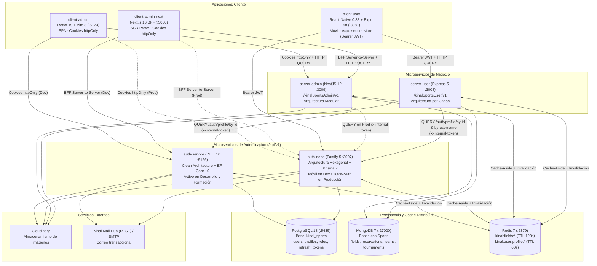

<div align="center">

# KinalSports

_Plataforma de gestión deportiva basada en arquitectura de microservicios._

**Fundación Kinal · 6to. Perito en Computación**

[](./LICENSE)
[](./package.json)
[](./authentication-service/auth-service/global.json)
[](./pnpm-workspace.yaml)
[](./docker-compose.yml)

</div>

---

**KinalSports** es una plataforma integral para la administración de complejos deportivos, reserva de canchas, gestión de equipos y organización de torneos. Está diseñada como un monorepo poliglota que integra cuatro microservicios backend, dos paneles web administrativos, una aplicación móvil nativa y una suite de pruebas automatizadas de contrato HTTP.

Desarrollado y orientado técnicamente en el marco formativo de **6to. Perito en Computación** de **[Fundación Kinal](https://www.kinal.org.gt/)** (Guatemala), el proyecto articula ingeniería de software aplicada, diseño arquitectónico verificable y formación técnica profesional bajo el principio institucional del **trabajo bien hecho**.

---

## Índice de Navegación

1. [¿Qué es KinalSports?](#1-qué-es-kinalsports)
2. [Funcionalidades Principales](#2-funcionalidades-principales)
3. [Tecnologías Utilizadas](#3-tecnologías-utilizadas)
4. [Arquitectura General](#4-arquitectura-general)
5. [Componentes del Monorepo](#5-componentes-del-monorepo)
6. [Quick Start](#6-quick-start)
7. [Configuración](#7-configuración)
8. [Desarrollo y Producción](#8-desarrollo-y-producción)
9. [Pruebas y Calidad](#9-pruebas-y-calidad)
10. [Propósito Didáctico y Formativo](#10-propósito-didáctico-y-formativo)
11. [Documentación Adicional](#11-documentación-adicional)
12. [Contribuciones](#12-contribuciones)
13. [Seguridad](#13-seguridad)
14. [Licencia](#14-licencia)
15. [Créditos y Contexto Institucional](#15-créditos-y-contexto-institucional)

---

## 1. ¿Qué es KinalSports?

**KinalSports** resuelve la operación completa de un complejo deportivo separando las responsabilidades administrativas de los flujos de autoservicio para deportistas y capitanes de equipo.

Desde el punto de vista de ingeniería de software, el monorepo demuestra cómo diversos stacks tecnológicos (**Node.js con Fastify, NestJS y Express**, junto con **ASP.NET Core en .NET 10**, **React 19**, **Next.js 16** y **React Native con Expo**) pueden interoperar sobre esquemas de datos compartidos, contratos criptográficos unificados y patrones de caché distribuida sin acoplamiento accidental.

---

## 2. Funcionalidades Principales

| Dominio Funcional                             | Capacidades Implementadas y Verificadas                                                                                                                                                                                                                                                                |
| :-------------------------------------------- | :----------------------------------------------------------------------------------------------------------------------------------------------------------------------------------------------------------------------------------------------------------------------------------------------------- |
| **Identidad, Autenticación y Roles (`auth`)** | Registro con fotografía de perfil, verificación de correo electrónico, recuperación de contraseña, emisión de tokens JWT (`HS256`, vigencia de 15 min), rotación de _refresh tokens_ con detección de reúso en PostgreSQL y control de acceso basado en roles (`ADMIN_ROLE` y `USER_ROLE`).            |
| **Catálogo de Canchas (`fields`)**            | Gestión administrativa de canchas (superficie `CESPED_SINTETICO`, `CESPED_NATURAL`, `CONCRETO`, `DUELA`; capacidad `FUTBOL_5`, `FUTBOL_7`, `FUTBOL_11`; tarifa por hora; fotografía en Cloudinary; activación y desactivación lógica) y búsqueda filtrada mediante `GET` o el método HTTP `QUERY`.     |
| **Reservaciones (`reservations`)**            | Consulta de disponibilidad horaria en la zona `America/Guatemala` (`06:00` a `22:00`), creación de reservas de 1 a 3 horas con validación de traslapes, cancelación por el usuario antes del inicio, y confirmación o cancelación administrativa con registro de motivo.                               |
| **Equipos Deportivos (`teams`)**              | Creación de equipos con logotipo en Cloudinary, asignación de capitán (`managerId`), unión o abandono de miembros registrados, incorporación por `username` o de integrantes invitados nombrados (`namedMembers`), y control de cupos máximos por categoría (`12` en `FUTBOL_7`, `18` en `FUTBOL_11`). |
| **Torneos (`tournaments`)**                   | Creación y publicación de torneos con imagen promocional, control de ciclo de vida (`PENDIENTE`, `EN_CURSO`, `FINALIZADO`, `CANCELADO`), validación de cupos (`maxTeams`) e inscripción de equipos activos por parte de sus capitanes.                                                                 |

---

## 3. Tecnologías Utilizadas

Todas las versiones listadas a continuación corresponden a las declaraciones verificadas en los archivos `package.json`, `pnpm-workspace.yaml`, `global.json`, `Directory.Build.props`, `.csproj` y `docker-compose*.yml` del repositorio.

### 3.1 Aplicaciones Web

| Tecnología                                                                                                                | Versión Verificada | Rol en el Proyecto                                                                                |
| :------------------------------------------------------------------------------------------------------------------------ | :----------------- | :------------------------------------------------------------------------------------------------ |
|                    | `^19.3.1`          | Librería de interfaz de usuario en `client-admin` y `client-admin-next`.                          |
|                        | `^8.3.7`           | Empaquetador y servidor de desarrollo HMR para la SPA `client-admin`.                             |
|            | `^16.4.6`          | Framework App Router con salida `standalone` y patrón Backend for Frontend (`client-admin-next`). |
|  | `^4.3.5`           | Sistema de diseño utilitario en ambas aplicaciones administrativas.                               |
|                                            | `^5.1.0`           | Gestión de estado de sesión en cliente con persistencia selectiva (`partialize`).                 |

### 3.2 Aplicación Móvil

| Tecnología                                                                                                            | Versión Verificada          | Rol en el Proyecto                                                                                                                          |
| :-------------------------------------------------------------------------------------------------------------------- | :-------------------------- | :------------------------------------------------------------------------------------------------------------------------------------------ |
|              | `~58.0.23`                  | Ecosistema móvil multiplataforma y herramientas nativas en `client-user`.                                                                   |
|  | `0.88.1` (`react` `19.3.0`) | Renderizado nativo Android / iOS, navegación con React Navigation 7 (`^7.5.1`) y almacenamiento cifrado en `expo-secure-store` (`~58.0.2`). |

### 3.3 Microservicios Backend

| Tecnología                                                                                                             | Versión Verificada                      | Rol en el Proyecto                                                                 |
| :--------------------------------------------------------------------------------------------------------------------- | :-------------------------------------- | :--------------------------------------------------------------------------------- |
|  | `>= 22.13.0` (`node:26-slim` en Docker) | Entorno de ejecución para `auth-node`, `server-admin` y `server-user`.             |
|           | `^5.12.8`                               | Servidor HTTP de alto rendimiento en `auth-node` con Arquitectura Hexagonal.       |
|                    | `net10.0` (SDK `10.0.100`, C# 14)       | Plataforma de `auth-service` con ASP.NET Core 10 (`10.0.14`) y Clean Architecture. |
|              | `^12.4.2`                               | Framework modular para la API administrativa `server-admin`.                       |
|            | `^5.3.0`                                | Framework HTTP para la API de operaciones de jugadores `server-user` (ESM nativo). |
|   | `~6.0.3`                                | Tipado estático en `auth-node`, `server-admin` y `client-admin-next`.              |

### 3.4 Persistencia, Caché, Infraestructura y Servicios Externos

| Categoría                   | Tecnologías y Versiones Verificadas                                                                                                                                                                                                                                                               |
| :-------------------------- | :------------------------------------------------------------------------------------------------------------------------------------------------------------------------------------------------------------------------------------------------------------------------------------------------ |
| **Persistencia Relacional** | **PostgreSQL 18** (`postgres:18`, puerto `5435`), accedido mediante **Prisma `7.10.1`** (`@prisma/adapter-pg`) en `auth-node` y **Entity Framework Core `10.0.14`** (`Npgsql.EntityFrameworkCore.PostgreSQL` `10.0.3`, `EFCore.NamingConventions` `10.0.1`) en `auth-service`.                    |
| **Persistencia Documental** | **MongoDB 7** (`mongo:7`, puerto `27020`), modelado con **Mongoose `^9.12.1`** tanto en `server-admin` (`@nestjs/mongoose` `^12.0.1`) como en `server-user`.                                                                                                                                      |
| **Caché Distribuida**       | **Redis 7** (`redis:7-alpine`, puerto `6379`), operado bajo patrón `Cache-Aside` mediante clientes TCP `RESP2` propios en los cuatro microservicios con degradación automática a memoria local.                                                                                                   |
| **Infraestructura**         | **Docker** y **Docker Compose** (`docker-compose.yml` para desarrollo, `docker-compose.prod.yml` para producción y `tests/contract/compose.contract.yml` para pruebas de contrato), **Nginx Unprivileged** (`1.27-alpine`) y **pnpm Workspaces** (`10.29.2`).                                     |
| **Servicios Externos**      | **Cloudinary** (`cloudinary` `^2.11.0` en Node.js y `CloudinaryDotNet` `1.29.3` en .NET) para almacenamiento de imágenes, y **Kinal Mail Hub (API REST)** / **SMTP** (`nodemailer` `^10.4.0`, `MailKit` `4.18.2`, **Mailpit** en pruebas de contrato) para correo transaccional.                  |
| **Pruebas y Calidad**       | **Vitest `^5.1.0`**, **xUnit v3 `4.0.3`** + **NSubstitute `6.2.0`** sobre `Microsoft.Testing.Platform`, **Jest `^30.5.2`** + `jest-expo` `~58.0.15`, **Testing Library**, **ESLint `^9.39.5`**, **Prettier `^3.9.10`**, **Husky `^9.1.7`**, **lint-staged `^15.5.2`** y **Commitlint `^19.8.1`**. |

---

## 4. Arquitectura General

El sistema implementa una arquitectura de microservicios con separación clara entre el plano de identidad (PostgreSQL 18), el plano de negocio deportivo (MongoDB 7) y una capa transversal de caché distribuida (Redis 7).



### Decisiones Arquitectónicas Clave

1. **Interoperabilidad real entre `.NET 10` y `Node.js`:** `auth-service` y `auth-node` operan sobre las mismas tablas de PostgreSQL 18, emplean los mismos parámetros `Argon2id` y firman tokens `HS256` con idénticos `SecretKey`, `Issuer` (`AuthService`) y `Audience` (`AuthService`).
2. **Protección de credenciales según plataforma:** Los clientes web (`client-admin` y `client-admin-next`) utilizan exclusivamente cookies `httpOnly` (`kinal_access` y `kinal_refresh`) y nunca persisten tokens en `localStorage` ni `sessionStorage`. La aplicación móvil (`client-user`) cifra los tokens en el dispositivo mediante `expo-secure-store`.
3. **Verificación de JWT en el patrón BFF:** El servidor de `client-admin-next` actúa como proxy inverso autenticado y verifica la coherencia estructural del rol en la navegación (`src/proxy.ts`), mientras que la **verificación criptográfica de la firma `HS256` del JWT ocurre en los microservicios backend** (`auth-service`, `auth-node` y `server-admin`).
4. **MongoDB y Redis compartidos en operaciones de negocio:** `server-admin` y `server-user` comparten la base documental `kinalSports` en MongoDB 7 y el espacio de claves `kinal:fields:*` (TTL 120 s) y `kinal:user:profile:*` (TTL 60 s) en Redis 7. Aunque `server-user` incluye un cliente HTTP hacia `server-admin`, sus consultas y validaciones de canchas leen directamente de MongoDB y Redis compartidos para evitar latencia de red innecesaria.
5. **Uso del método HTTP `QUERY`:** Los servicios soportan peticiones `QUERY` con cuerpo JSON estructurado tanto para el filtrado avanzado de canchas como para las consultas internas de perfiles autenticadas con la cabecera `x-internal-token`.

Para profundizar en los diagramas de contenedores, flujos de secuencia y decisiones de diseño, consulta la **[Guía de Arquitectura del Sistema](./docs/ARCHITECTURE.md)**.

---

## 5. Componentes del Monorepo

| Componente          | Tecnología                               | Responsabilidad                                                                                      | Documentación                                                                                                                                                                                                                |
| :------------------ | :--------------------------------------- | :--------------------------------------------------------------------------------------------------- | :--------------------------------------------------------------------------------------------------------------------------------------------------------------------------------------------------------------------------- |
| `auth-node`         | Fastify 5 + TypeScript 6 + Prisma 7      | Autenticación con Arquitectura Hexagonal (Móvil en desarrollo y 100% de autenticación en producción) | [README](./authentication-service/auth-node/README.md)                                                                                                                                                                       |
| `auth-service`      | ASP.NET Core 10 + EF Core 10 (C# 14)     | Autenticación educativa y de desarrollo bajo Clean Architecture                                      | [README](./authentication-service/auth-service/README.md) · [Guía Rápida](./authentication-service/auth-service/GUIA_RAPIDA.md) · [Flujo Paso a Paso](./authentication-service/auth-service/FLUJO_RECREACION_PASO_A_PASO.md) |
| `server-admin`      | NestJS 12 + TypeScript 6 + Mongoose 9    | Administración de canchas, reservaciones, equipos y torneos (Arquitectura Modular)                   | [README](./server-admin/README.md)                                                                                                                                                                                           |
| `server-user`       | Express 5 (ESM) + Mongoose 9             | Operaciones de jugadores, reservas, equipos e inscripción a torneos (Arquitectura por Capas)         | [README](./server-user/README.md)                                                                                                                                                                                            |
| `client-admin`      | React 19 + Vite 8 + TailwindCSS 4        | Panel administrativo web tipo Single Page Application (SPA)                                          | [README](./client-admin/README.md)                                                                                                                                                                                           |
| `client-admin-next` | Next.js 16.4 (App Router) + TypeScript 6 | Panel administrativo web bajo patrón Backend for Frontend (BFF)                                      | [README](./client-admin-next/README.md)                                                                                                                                                                                      |
| `client-user`       | React Native 0.88 + Expo SDK 58          | Aplicación móvil multiplataforma para deportistas y capitanes                                        | [README](./client-user/README.md)                                                                                                                                                                                            |
| `tests/contract`    | Vitest 5 + Mailpit                       | Suite de pruebas de contrato HTTP en caja negra con validación de snapshots                          | [README](./tests/contract/README.md)                                                                                                                                                                                         |

<details>
<summary><strong>Ver árbol de directorios del monorepo</strong></summary>

```text
mono_repo_kinalSports/
├── authentication-service/
│   ├── auth-node/              # Microservicio de autenticación en Node.js + Fastify + Prisma
│   └── auth-service/           # Microservicio de autenticación en .NET 10 + EF Core (Clean Architecture)
├── server-admin/               # API administrativa en NestJS 12 + Mongoose
├── server-user/                # API de operaciones de usuario en Express 5 + Mongoose
├── client-admin/               # Panel administrativo SPA en React 19 + Vite 8
├── client-admin-next/          # Panel administrativo BFF en Next.js 16 (App Router)
├── client-user/                # Aplicación móvil en React Native 0.88 + Expo SDK 58
├── tests/
│   └── contract/               # Pruebas de contrato HTTP de caja negra (Vitest + Mailpit)
├── docs/                       # Documentación transversal de arquitectura, operación y pruebas
├── scripts/
│   └── seed/                   # Script de carga y reinicio de datos iniciales en contenedores Docker
├── dockerfiles/                # Dockerfiles multi-stage por componente (dev, runtime, migrator)
├── .github/                    # Plantillas de Pull Request y reporte de Issues
├── .husky/                     # Git hooks (pre-commit, commit-msg, pre-push)
├── docker-compose.yml          # Orquestación de desarrollo (.NET 10 + Node.js + Postgres + Mongo + Redis)
├── docker-compose.prod.yml     # Orquestación de producción (100% Node.js + Postgres + Mongo + Redis)
├── package.json                # Scripts globales y configuración de lint-staged / Commitizen
└── pnpm-workspace.yaml         # Definición de workspaces, allowBuilds y overrides de seguridad
```

</details>

---

## 6. Quick Start

### 6.1 Requisitos Previos

- **Node.js:** `>= 22.13.0` (`.nvmrc` sugiere Node `24` para desarrollo local; los contenedores usan `node:26-slim`).
- **pnpm:** `>= 10` (`packageManager: pnpm@10.29.2`).
- **.NET SDK:** `10.0.x` (`global.json` define `10.0.100` con `rollForward: latestFeature`). Requerido para compilar y probar `auth-service` y para el hook `.husky/pre-commit`.
- **Docker y Docker Compose:** Requeridos para levantar el ecosistema contenerizado, sembrar datos (`pnpm db:seed`) y ejecutar pruebas de contrato.

### 6.2 Clonación e Instalación de Dependencias

```bash
git clone https://github.com/6toInformatica/mono_repo_kinalSports.git
cd mono_repo_kinalSports
pnpm install
```

### 6.3 Ejecución con Docker Compose (Entorno de Desarrollo)

El archivo `docker-compose.yml` cuenta con valores por defecto seguros para desarrollo local. Si necesitas configurar credenciales externas (como `KMH_PROJECT_API_KEY` o `CLOUDINARY_*`), puedes definirlas opcionalmente en un archivo `.env.docker` en la raíz:

```bash
# 1. Crear archivo .env.docker opcional para variables de Docker Compose
touch .env.docker

# 2. Construir y levantar el stack completo en segundo plano
pnpm docker:up:detached

# 3. Poblar PostgreSQL y MongoDB con datos iniciales de prueba
pnpm db:seed

# 4. Consultar bitácoras en tiempo real
pnpm docker:logs
```

> **Credenciales de desarrollo generadas por `pnpm db:seed`:** Todos los usuarios sembrados en el entorno local utilizan la contraseña de prueba `Admin1234!` (incluyendo el administrador inicial `admin@ksports.local` / usuario `admin`).

### 6.4 Verificación de Servicios Activos

Una vez que los contenedores alcancen el estado `healthy`, los servicios estarán disponibles en los siguientes puertos locales:

| Servicio / Aplicación                  | URL Local / Endpoint de Verificación                             |
| :------------------------------------- | :--------------------------------------------------------------- |
| `client-admin` (React + Vite SPA)      | `http://localhost:5173`                                          |
| `client-admin-next` (Next.js 16 BFF)   | `http://localhost:3000`                                          |
| `client-user` (Expo Metro Bundler)     | `http://localhost:8081`                                          |
| `auth-service` (.NET 10 API + Swagger) | `http://localhost:5156/health` · `http://localhost:5156/swagger` |
| `auth-node` (Fastify API)              | `http://localhost:3007/api/v1/health`                            |
| `server-admin` (NestJS API)            | `http://localhost:3009/kinalSportsAdmin/v1/health`               |
| `server-user` (Express 5 API)          | `http://localhost:3008/kinalSportsUser/v1/health`                |

Para detener el entorno de desarrollo:

```bash
pnpm docker:down
```

<details>
<summary><strong>Ejecución en Desarrollo Local sin Docker (Paso a Paso)</strong></summary>

Si prefieres ejecutar los servicios directamente en tu máquina anfitriona (contando con PostgreSQL 18 en `:5435`, MongoDB 7 en `:27020` y opcionalmente Redis 7 en `:6379`):

1. Copia las plantillas de variables de entorno de cada paquete (ver [Sección 7](#7-configuración)).
2. Ejecuta los servicios deseados en terminales independientes:

```bash
pnpm --filter auth-service dev            # .NET 10 en http://localhost:5156
pnpm --filter auth-node dev               # Fastify en http://localhost:3007
pnpm --filter server-admin dev            # NestJS en http://localhost:3009
pnpm --filter server-user dev             # Express en http://localhost:3008
pnpm --filter @kinal/client-admin dev     # Vite SPA en http://localhost:5173
pnpm --filter @kinal/client-admin-next dev # Next.js BFF en http://localhost:3000
pnpm --filter client-user start           # Expo Metro en puerto 8081
```

</details>

---

## 7. Configuración

Ningún archivo `.env`, `.env.local`, `.env.docker` ni `appsettings.Development.json` debe incorporarse al control de versiones. Cada paquete incluye su plantilla de referencia:

| Componente          | Plantilla Versionada                                                                                                                                                                             | Archivo Destino Local                                                                  | Variables Críticas                                                                                                                   |
| :------------------ | :----------------------------------------------------------------------------------------------------------------------------------------------------------------------------------------------- | :------------------------------------------------------------------------------------- | :----------------------------------------------------------------------------------------------------------------------------------- |
| **Docker Compose**  | [`.env.docker.example`](./.env.docker.example)                                                                                                                                                   | `.env.docker`                                                                          | Opcional en desarrollo; en producción exige `POSTGRES_USER`, `POSTGRES_PASSWORD`, `JWT_SECRET` e `INTERNAL_SERVICE_TOKEN`.           |
| `auth-node`         | [`authentication-service/auth-node/.env.example`](./authentication-service/auth-node/.env.example)                                                                                               | `authentication-service/auth-node/.env`                                                | `DB_*`, `JWT_SECRET` (mín. 32 caracteres), `INTERNAL_SERVICE_TOKEN`, `REDIS_URL`, `MAIL_PROVIDER`, `CLOUDINARY_*`.                   |
| `auth-service`      | [`authentication-service/auth-service/src/AuthService.Api/appsettings.Development.example.json`](./authentication-service/auth-service/src/AuthService.Api/appsettings.Development.example.json) | `authentication-service/auth-service/src/AuthService.Api/appsettings.Development.json` | `ConnectionStrings:DefaultConnection` (`Port=5435`), `JwtSettings`, `InternalServiceToken`, `Redis:ConnectionString`.                |
| `server-admin`      | [`server-admin/.env.example`](./server-admin/.env.example)                                                                                                                                       | `server-admin/.env`                                                                    | `URI_MONGODB`, `JWT_SECRET`, `AUTH_SERVICE_URL` (`:5156` en dev / `:3007` en prod), `INTERNAL_SERVICE_TOKEN`, `REDIS_URL`.           |
| `server-user`       | [`server-user/.env.example`](./server-user/.env.example)                                                                                                                                         | `server-user/.env`                                                                     | `URI_MONGODB`, `JWT_SECRET`, `AUTH_NODE_URL` (`:3007`), `ADMIN_SERVICE_URL`, `INTERNAL_SERVICE_TOKEN`, `REDIS_URL`.                  |
| `client-admin`      | [`client-admin/.env.example`](./client-admin/.env.example)                                                                                                                                       | `client-admin/.env`                                                                    | `VITE_AUTH_URL`, `VITE_ADMIN_URL`, `VITE_CLOUDINARY_BASE_URL`.                                                                       |
| `client-admin-next` | [`client-admin-next/.env.example`](./client-admin-next/.env.example)                                                                                                                             | `client-admin-next/.env.local`                                                         | `AUTH_API_URL` y `ADMIN_API_URL` (exclusivas de servidor) y `NEXT_PUBLIC_CLOUDINARY_BASE_URL`.                                       |
| `client-user`       | [`client-user/.env.example`](./client-user/.env.example)                                                                                                                                         | `client-user/.env`                                                                     | `EXPO_PUBLIC_AUTH_URL` y `EXPO_PUBLIC_USER_URL` (`10.0.2.2` en emulador Android, `localhost` en iOS o IP LAN en dispositivo físico). |

> **Regla de sincronización criptográfica:** Los valores de `JWT_SECRET`, `JWT_ISSUER` (`AuthService`), `JWT_AUDIENCE` (`AuthService`) e `INTERNAL_SERVICE_TOKEN` deben coincidir exactamente entre `auth-node`, `auth-service`, `server-admin` y `server-user`.

---

## 8. Desarrollo y Producción

El repositorio provee dos topologías de despliegue en Docker Compose diseñadas para responder a necesidades operativas distintas:

| Criterio                         | Desarrollo (`docker-compose.yml`)                                                                                             | Producción (`docker-compose.prod.yml`)                                                                                                      |
| :------------------------------- | :---------------------------------------------------------------------------------------------------------------------------- | :------------------------------------------------------------------------------------------------------------------------------------------ |
| **Comando de arranque**          | `pnpm docker:up:detached`                                                                                                     | `pnpm docker:prod:up`                                                                                                                       |
| **Servicios de autenticación**   | Ejecuta en paralelo `auth-service` (`.NET 10`, `:5156`) y `auth-node` (`Fastify`, `:3007`).                                   | Ejecuta **únicamente `auth-node` (`:3007`)** (topología 100% Node.js, sin requerir el runtime de `.NET`).                                   |
| **Inicialización de PostgreSQL** | El contenedor efímero `auth-migrator` aplica las migraciones de EF Core y siembra roles/admin antes de iniciar los servicios. | `auth-node` verifica `SELECT to_regclass('users')` e inicializa de forma idempotente el esquema SQL canónico, los roles y el admin inicial. |
| **Consumo administrativo**       | `client-admin`, `client-admin-next` y `server-admin` se autentican contra `auth-service` (`:5156`).                           | `client-admin`, `client-admin-next` y `server-admin` se autentican contra `auth-node` (`:3007`).                                            |
| **Consumo móvil / usuario**      | `client-user` y `server-user` apuntan a `auth-node` (`:3007`).                                                                | `server-user` apunta a `auth-node` (`:3007`). `client-user` se distribuye como binario móvil nativo, no como contenedor web.                |
| **Target de Dockerfile**         | Etapa `dev` con código montado por volumen y recarga en caliente (`nodemon`, `dotnet watch`, `vite`, `next dev`).             | Etapa `runtime` compilada y ejecutada con usuarios sin privilegios (`USER node`, `$APP_UID` y `nginxinc/nginx-unprivileged:1.27-alpine`).   |
| **Gestión de secretos**          | Incluye valores por defecto para agilizar prácticas de laboratorio.                                                           | Exige definir obligatoriamente `POSTGRES_USER`, `POSTGRES_PASSWORD`, `JWT_SECRET` e `INTERNAL_SERVICE_TOKEN` en `.env.docker`.              |

---

## 9. Pruebas y Calidad

El monorepo cuenta con verificación automatizada en dos niveles complementarios: **pruebas unitarias aisladas** (que no requieren Docker ni bases de datos activas) y **pruebas de contrato HTTP de caja negra**.

### 9.1 Comandos Globales de Verificación

```bash
# Ejecutar todas las suites de pruebas unitarias (Node.js + .NET 10 + React + React Native)
pnpm test

# Analizar el código con ESLint en los paquetes del monorepo
pnpm lint

# Formatear código en server-admin y server-user con Prettier
pnpm format

# Compilar todos los paquetes que definen script "build"
pnpm -r --if-present build
```

### 9.2 Ejecución de Pruebas Unitarias por Componente

| Componente          | Framework de Pruebas                       | Comando de Ejecución                          |
| :------------------ | :----------------------------------------- | :-------------------------------------------- |
| `auth-node`         | Vitest 5                                   | `pnpm --filter auth-node test`                |
| `auth-service`      | xUnit v3 (`4.0.3`) + NSubstitute (`6.2.0`) | `pnpm --filter auth-service test`             |
| `server-admin`      | Vitest 5 + SWC                             | `pnpm --filter server-admin test`             |
| `server-user`       | Vitest 5                                   | `pnpm --filter server-user test`              |
| `client-admin`      | Vitest 5 + React Testing Library           | `pnpm --filter @kinal/client-admin test`      |
| `client-admin-next` | Vitest 5 + React Testing Library           | `pnpm --filter @kinal/client-admin-next test` |
| `client-user`       | Jest 30 + `jest-expo`                      | `pnpm --filter client-user test`              |

### 9.3 Pruebas de Contrato HTTP

Levantan el ecosistema con `tests/contract/compose.contract.yml` (que incorpora **Mailpit** en `http://localhost:8025` para capturar correos transaccionales y amplía las ventanas de _rate limit_) y verifican el contrato HTTP contra los snapshots en `tests/contract/specs/__snapshots__/`:

```bash
pnpm contract:up
pnpm db:seed
pnpm test:contract
```

---

## 10. Propósito Didáctico y Formativo

**KinalSports** no es un ejercicio escolar aislado, sino una plataforma funcional diseñada como laboratorio de ingeniería de software para los estudiantes de **6to. Perito en Computación** de **Fundación Kinal**. Su estudio y evolución permiten aplicar en un contexto real:

- **Estilos arquitectónicos comparados:**
  - _Clean Architecture_ en `.NET 10` (`auth-service`).
  - _Arquitectura Hexagonal (Puertos y Adaptadores)_ en `Fastify + TypeScript` (`auth-node`).
  - _Arquitectura Modular orientada a decoradores e inyección de dependencias_ en `NestJS` (`server-admin`).
  - _Arquitectura por Capas_ en `Express 5 ESM` (`server-user`).
  - _Single Page Application (SPA)_ en `React + Vite` (`client-admin`) frente a _Backend for Frontend (BFF)_ en `Next.js App Router` (`client-admin-next`).
  - _Desarrollo móvil multiplataforma_ con almacenamiento seguro nativo en `React Native + Expo` (`client-user`).
- **Persistencia poliglota y caché distribuida:** Modelado relacional normalizado en PostgreSQL 18, modelado documental en MongoDB 7 y estrategia `Cache-Aside` con invalidación selectiva sobre Redis 7.
- **Seguridad de aplicaciones:** Hashing `Argon2id`, rotación de _refresh tokens_, cookies `httpOnly`, protección CSRF `Same-Origin`, prevención de IDOR y autenticación interna entre servicios.
- **Calidad, pruebas y despliegue:** Pruebas unitarias con dobles en memoria, pruebas de contrato HTTP, hooks de calidad con Husky/Commitlint y construcción de contenedores multi-etapa sin privilegios.

---

## 11. Documentación Adicional

### Guías Transversales del Monorepo

- **[Arquitectura Detallada del Sistema](./docs/ARCHITECTURE.md):** Diagramas C4/Mermaid, flujos de autenticación web/BFF/móvil, interoperabilidad `.NET 10` ↔ `Node.js`, modelo de datos y estrategia de caché en Redis.
- **[Operación, Desarrollo, Pruebas y Solución de Problemas](./docs/DEVELOPMENT_AND_OPERATIONS.md):** Flujo de desarrollo local y con Docker, despliegue en producción, matriz de puertos, comandos de sembrado y diagnóstico de errores frecuentes (_Troubleshooting_).

### Guías Educativas de Recreación en .NET 10

- **[Guía Rápida de Recreación de `auth-service`](./authentication-service/auth-service/GUIA_RAPIDA.md)**
- **[Flujo Lógico Paso a Paso para Recrear la API en `.NET 10`](./authentication-service/auth-service/FLUJO_RECREACION_PASO_A_PASO.md)**

---

## 12. Contribuciones

La participación en este repositorio se realiza dentro del proceso formativo y técnico de **6to. Perito en Computación** de **Fundación Kinal**, guiado por los valores de **trabajo bien hecho**, **espíritu de servicio**, **respeto a la dignidad de la persona** y **libertad personal responsable**.

Antes de crear una rama, realizar un commit o abrir un Pull Request, revisa:

- **[Guía de Colaboración y Contribución](./CONTRIBUTING.md):** Roles de participación, flujo de trabajo en 9 pasos, convenciones de ramas, reglas de **Conventional Commits** validadas por Husky/Commitlint y lineamientos para el uso ético y verificado de herramientas de Inteligencia Artificial.
- **[Código de Conducta](./CODE_OF_CONDUCT.md):** Principios de convivencia, integridad académica, respeto a la autoría, revisión constructiva de código y uso responsable de la infraestructura compartida.

---

## 13. Seguridad

La protección de credenciales, sesiones y datos forma parte esencial del diseño de **KinalSports**. Si identificas una vulnerabilidad o un riesgo de exposición de secretos:

- **No abras un Issue público** con detalles explotables.
- Consulta los controles implementados y el procedimiento de divulgación coordinada en la **[Política de Seguridad](./SECURITY.md)**.

---

## 14. Licencia

Este proyecto se distribuye bajo los términos de la **[Licencia MIT](./LICENSE)** (`SPDX-License-Identifier: MIT`). Consulta el archivo de licencia en la raíz del repositorio y los avisos de cada paquete para conocer las condiciones de uso, copia, modificación y distribución, así como la preservación obligatoria de los avisos de derechos de autor.

---

## 15. Créditos y Contexto Institucional

- **Institución educativa:** **[Fundación Kinal](https://www.kinal.org.gt/)** (Centro Educativo Técnico Laboral Kinal, Guatemala) — institución educativa privada y no lucrativa dedicada a la formación técnica, tecnológica y humana.
- **Contexto académico:** **6to. Perito en Computación** (en sus distintas jornadas y secciones técnicas), como proyecto técnico y formativo de referencia en ingeniería de software y arquitectura de sistemas.
- **Desarrollo y arquitectura técnica:** **Braulio Echeverría** (`Braulio Echeverria`), reconocido en los metadatos técnicos del repositorio por el diseño arquitectónico, desarrollo de software, integración de tecnologías modernas y orientación técnica de futuros desarrolladores. Esta atribución reconoce su autoría y responsabilidad técnica sobre el proyecto, diferenciándola de la titularidad patrimonial de derechos de autor.
- **Colaboración estudiantil:** Estudiantes de **6to. Perito en Computación** (referenciados en los metadatos del repositorio bajo el identificador de grado `IN6`) que participan en el estudio, pruebas y evolución controlada de los módulos.
- **Titularidad de derechos de autor:** La titularidad institucional propuesta para la unificación bajo licencia **MIT** corresponde a **Fundación Kinal**, sujeta a la confirmación formal de los derechos y la autorización correspondiente, conservando los avisos legales de terceros y contribuyentes que correspondan. Mientras dicha confirmación no se aplique sobre los archivos `LICENSE`, se mantienen vigentes los avisos actuales del repositorio sin asumir cotitularidad automática.
