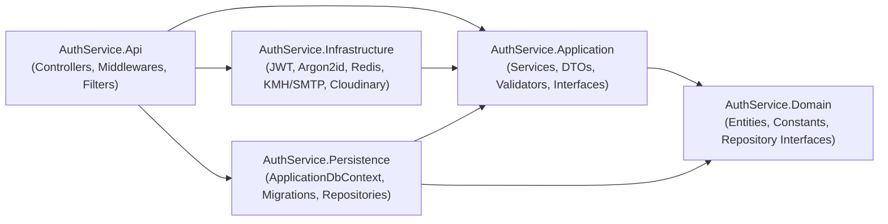

# Auth Service — Microservicio de Autenticación (.NET 10)

## 1. Propósito del Componente

`auth-service` es el microservicio de autenticación y control de acceso construido con **ASP.NET Core 10 (`net10.0`)**, **Entity Framework Core 10** y **PostgreSQL 18** bajo los principios de **Clean Architecture**.

En el contexto técnico y formativo de **Fundación Kinal**, este componente cumple un doble propósito:

1. Servir como implementación de referencia en C# / .NET 10 con separación estricta de capas (`Domain`, `Application`, `Infrastructure`, `Persistence`, `Api`).
2. Demostrar interoperabilidad real en una arquitectura de microservicios: comparte exactamente la misma base de datos PostgreSQL, la misma caché en Redis (`kinal:user:profile:{userId}`), los mismos parámetros Argon2id y el mismo formato de token JWT (`HS256`) que `auth-node` (Node.js + Fastify).

---

## 2. Responsabilidad dentro de KinalSports

- **En el entorno de desarrollo y formación (`docker-compose.yml`):**
    - El contenedor efímero `auth-migrator` (construido desde el mismo `Dockerfile.auth-service` con `--migrate-only`) aplica las migraciones de EF Core sobre PostgreSQL 18 y siembra los datos base al arrancar el entorno.
    - `auth-service` (`:5156`) atiende la autenticación de los paneles administrativos (`client-admin` y `client-admin-next`) y las consultas internas de perfiles desde `server-admin`.
- **En el entorno de producción (`docker-compose.prod.yml`):**
    - Cuando el despliegue se realiza en infraestructura que no dispone del runtime de Microsoft (.NET), `auth-service` no se ejecuta y `auth-node` (`:3007`) asume el 100% del tráfico de autenticación manteniendo el mismo contrato HTTP y esquema de datos.

---

## 3. Stack Tecnológico Verificado

| Categoría                         | Paquete / Versión (`.csproj` y `Directory.Build.props`)                                                                                                        | Uso en el Servicio                                                                                                    |
| :-------------------------------- | :------------------------------------------------------------------------------------------------------------------------------------------------------------- | :-------------------------------------------------------------------------------------------------------------------- |
| **Plataforma y Lenguaje**         | `.NET 10.0` (`net10.0`), C# `14.0` (`global.json`: SDK `10.0.100`, `rollForward: latestFeature`)                                                               | Runtime principal y compilación de la solución `AuthService.sln`.                                                     |
| **Framework Web**                 | `Microsoft.AspNetCore.OpenApi` `10.0.14`, `Swashbuckle.AspNetCore` `10.3.1`                                                                                    | Controladores REST, filtros, _model binders_ y documentación OpenAPI / Swagger.                                       |
| **ORM y Persistencia**            | `Microsoft.EntityFrameworkCore` `10.0.14`, `Npgsql.EntityFrameworkCore.PostgreSQL` `10.0.3`, `EFCore.NamingConventions` `10.0.1`                               | Mapeo objeto-relacional con convención `snake_case` sobre PostgreSQL 18.                                              |
| **Seguridad y Criptografía**      | `Microsoft.AspNetCore.Authentication.JwtBearer` `10.0.14`, `Konscious.Security.Cryptography.Argon2` `1.3.1`, `NetEscapades.AspNetCore.SecurityHeaders` `1.3.1` | Autenticación JWT (Bearer y cookie `httpOnly`), hashing Argon2id y cabeceras de seguridad.                            |
| **Caché Distribuida**             | `RedisCacheService` (`src/AuthService.Infrastructure/Cache/RedisCacheService.cs`)                                                                              | Cliente TCP `RESP2` para Redis 7 con patrón `Cache-Aside` y fallback en memoria (`ConcurrentDictionary`).             |
| **Validación, Correo y Archivos** | `FluentValidation` `12.2.0`, `MailKit` `4.18.2`, `CloudinaryDotNet` `1.29.3`, `Serilog.AspNetCore` `10.0.0`                                                    | Validación de DTOs, envío de correos por Kinal Mail Hub (REST) o SMTP, subida a Cloudinary y bitácoras estructuradas. |
| **Pruebas Unitarias**             | `xunit.v3` `4.0.3`, `NSubstitute` `6.2.0`, `Microsoft.Testing.Extensions.CodeCoverage` `18.12.0`                                                               | Pruebas unitarias de casos de uso e infraestructura sobre `Microsoft.Testing.Platform`.                               |

---

## 4. Arquitectura Interna (Clean Architecture)

La solución `AuthService.sln` se divide en **5 proyectos de código fuente** (`src/`) y **2 proyectos de pruebas** (`tests/`), donde las dependencias apuntan siempre hacia adentro (hacia `Domain`):



1. **`AuthService.Domain`:** No depende de ningún paquete externo. Contiene las entidades (`User`, `UserProfile`, `Role`, `UserRole`, `UserEmail`, `UserPasswordReset`, `RefreshToken`), constantes (`RoleConstants`) y las interfaces de repositorio (`IUserRepository`, `IRoleRepository`, `IRefreshTokenRepository`).
2. **`AuthService.Application`:** Contiene la lógica de aplicación (`AuthService`, `UserManagementService`, `RefreshTokenService`), los DTOs de entrada/salida, validadores con `FluentValidation` y los puertos de infraestructura (`IJwtTokenService`, `IPasswordHashService`, `IEmailService`, `ICloudinaryService`, `ICacheService`).
3. **`AuthService.Infrastructure`:** Implementa los adaptadores externos registrados en `DependencyInjection.AddInfrastructure`: `PasswordHashService` (Argon2id), `JwtTokenService`, `RedisCacheService`, `KinalMailHubEmailService` (API REST), `EmailService` (SMTP con MailKit) y `CloudinaryService`.
4. **`AuthService.Persistence`:** Contiene `ApplicationDbContext`, las migraciones de EF Core, los repositorios concretos (`UserRepository`, `RoleRepository`, `RefreshTokenRepository`) y `DataSeeder`.
5. **`AuthService.Api`:** Expone los controladores HTTP (`AuthController`, `UsersController`, `HealthController`), la gestión de cookies `httpOnly`, el filtro `[InternalServiceToken]`, el middleware global de errores y `Program.cs`.

---

## 5. Estructura Principal del Directorio

```text
authentication-service/auth-service/
├── AuthService.sln
├── Directory.Build.props                   # Define net10.0, LangVersion 14.0 y analizadores .NET
├── global.json                             # Fija SDK 10.0.100 con rollForward: latestFeature
├── package.json                            # Scripts puente para ejecutar dotnet desde pnpm
├── GUIA_RAPIDA.md                          # Guía resumida de recreación paso a paso en .NET 10
├── FLUJO_RECREACION_PASO_A_PASO.md         # Tutorial detallado de construcción de la solución
├── src/
│   ├── AuthService.Domain/
│   ├── AuthService.Application/
│   ├── AuthService.Infrastructure/
│   ├── AuthService.Persistence/
│   └── AuthService.Api/
└── tests/
    ├── AuthService.Application.Tests/
    └── AuthService.Infrastructure.Tests/
```

---

## 6. Requisitos

- **.NET SDK:** `10.0.x` (verificable con `dotnet --version`).
- **PostgreSQL:** `18` (puerto `5435` en el host cuando se levanta con Docker Compose).
- **Redis:** `7+` (opcional en desarrollo local gracias al fallback en memoria de `RedisCacheService`).

---

## 7. Configuración y Variables de Entorno

Para desarrollo local fuera de Docker, copia el archivo de ejemplo `appsettings.Development.example.json`:

```bash
cp authentication-service/auth-service/src/AuthService.Api/appsettings.Development.example.json \
   authentication-service/auth-service/src/AuthService.Api/appsettings.Development.json
```

> **Nota sobre `appsettings.Development.example.json`:**
> La plantilla incluye los parámetros alineados con el contenedor PostgreSQL del monorepo (`Port=5435`, `Database=kinal_sports`, `Username=KinalSports`, `Redis:ConnectionString`). Verifica o personaliza los siguientes valores en tu `appsettings.Development.json` (no versionado):

```json
{
    "ConnectionStrings": {
        "DefaultConnection": "Host=localhost;Port=5435;Database=kinal_sports;Username=KinalSports;Password=KinalSports2027!"
    },
    "InternalServiceToken": "KinalSportsInternalSecretToken2026!",
    "JwtSettings": {
        "SecretKey": "MyVerySecretKeyForJWTTokenAuthenticationWith256Bits!",
        "Issuer": "AuthService",
        "Audience": "AuthService",
        "ExpiryInMinutes": 15
    },
    "Seed": {
        "AdminPassword": "Admin1234!"
    },
    "Redis": {
        "ConnectionString": "redis://localhost:6379"
    },
    "Email": {
        "Provider": "kmh"
    },
    "KinalMailHub": {
        "BaseUrl": "https://mail.lab.kinal.edu.gt",
        "From": "kinal-sports@am-delta.in6am.mail.kinal.test",
        "ApiKey": ""
    },
    "AppSettings": {
        "FrontendUrl": "http://localhost:5173"
    }
}
```

`RedisCacheService` lee la cadena de conexión desde `Redis:ConnectionString` o desde la variable de entorno `REDIS_URL`.

---

## 8. Ejecución Local

### Desde la raíz del monorepo (vía `pnpm`)

```bash
pnpm --filter auth-service dev      # Ejecuta dotnet watch en http://localhost:5156
pnpm --filter auth-service build    # Compila la solución completa
pnpm --filter auth-service start    # Ejecuta dotnet run sobre AuthService.Api
pnpm --filter auth-service test     # Ejecuta las pruebas unitarias con dotnet test
pnpm --filter auth-service format   # Ejecuta dotnet format sobre AuthService.sln
```

### Directamente con `.NET CLI`

```bash
cd authentication-service/auth-service
dotnet restore
dotnet run --project src/AuthService.Api
```

- **URL base:** `http://localhost:5156/api/v1`
- **Swagger UI (solo en entorno `Development`):** `http://localhost:5156/swagger`
- **Modo solo migración:** `dotnet run --project src/AuthService.Api -- --migrate-only` (aplica las migraciones de EF Core, ejecuta `DataSeeder` y finaliza el proceso).

---

## 9. Integraciones y Referencia de Endpoints

**Prefijo base:** `/api/v1`

### 9.1 Controlador de Autenticación (`AuthController` — `/api/v1/auth`)

| Método           | Ruta                           | Descripción                                                                                               | Autenticación                                 |
| :--------------- | :----------------------------- | :-------------------------------------------------------------------------------------------------------- | :-------------------------------------------- |
| `POST`           | `/auth/register`               | Registra un usuario nuevo (`[FromForm] RegisterDto`) y envía correo de verificación.                      | Público (`AuthPolicy`)                        |
| `POST`           | `/auth/verify-email`           | Verifica el correo electrónico con `{ token }` e invalida `kinal:user:profile:{userId}` en Redis.         | Público (`AuthPolicy`)                        |
| `POST`           | `/auth/resend-verification`    | Reenvía el enlace de verificación al correo indicado.                                                     | Público (`AuthPolicy`)                        |
| `POST`           | `/auth/login`                  | Inicia sesión, devuelve JWT + `refreshToken` y fija cookies `httpOnly` (`kinal_access`, `kinal_refresh`). | Público (`AuthPolicy`)                        |
| `POST`           | `/auth/refresh`                | Rota el `refreshToken` (desde body o cookie `kinal_refresh`) y emite un nuevo `accessToken`.              | Body o cookie `kinal_refresh`                 |
| `POST`           | `/auth/logout`                 | Revoca el `refreshToken` y elimina las cookies `httpOnly`.                                                | Body o cookie `kinal_refresh`                 |
| `POST`           | `/auth/forgot-password`        | Envía enlace de restablecimiento de contraseña.                                                           | Público (`AuthPolicy`)                        |
| `POST`           | `/auth/reset-password`         | Restablece la contraseña y revoca los _refresh tokens_ activos del usuario.                               | Público (`AuthPolicy`)                        |
| `GET`            | `/auth/profile`                | Obtiene el perfil del usuario autenticado (lee/escribe `kinal:user:profile:{userId}` en Redis).           | JWT (`Bearer` o cookie `kinal_access`)        |
| `POST`           | `/auth/profile/picture`        | Actualiza la foto de perfil (`profilePicture`) e invalida la caché en Redis.                              | JWT (`Bearer` o cookie `kinal_access`)        |
| `POST`           | `/auth/profile/picture/avatar` | Alias para actualizar la foto de perfil (`avatar` o `profilePicture`).                                    | JWT (`Bearer` o cookie `kinal_access`)        |
| `GET`            | `/auth/users`                  | Lista todos los usuarios registrados.                                                                     | JWT (`ADMIN_ROLE`)                            |
| `QUERY` / `POST` | `/auth/profile/by-id`          | Consulta interna de perfil por `{ userId }` (`[AcceptVerbs("QUERY", "POST")]`).                           | `[InternalServiceToken]` (`x-internal-token`) |
| `QUERY` / `POST` | `/auth/profile/by-username`    | Consulta interna de perfil por `{ username }` (`[AcceptVerbs("QUERY", "POST")]`).                         | `[InternalServiceToken]` (`x-internal-token`) |

### 9.2 Controlador de Usuarios/Roles (`UsersController` — `/api/v1/users`) y Salud

| Método | Ruta                         | Descripción                                                                                  | Autenticación      |
| :----- | :--------------------------- | :------------------------------------------------------------------------------------------- | :----------------- |
| `PUT`  | `/users/{userId}/role`       | Cambia el rol de un usuario (`ADMIN_ROLE` / `USER_ROLE`) e invalida su caché en Redis.       | JWT (`ADMIN_ROLE`) |
| `GET`  | `/users/{userId}/roles`      | Consulta los roles asignados a un usuario (valida que sea el propio usuario o `ADMIN_ROLE`). | JWT                |
| `GET`  | `/users/by-role/{roleName}`  | Lista los usuarios pertenecientes a un rol.                                                  | JWT (`ADMIN_ROLE`) |
| `GET`  | `/health` y `/api/v1/health` | Verifica el estado de salud del servicio.                                                    | Público            |

---

## 10. Pruebas

La solución cuenta con dos proyectos de pruebas unitarias sobre **xUnit v3** y **NSubstitute**:

- `tests/AuthService.Application.Tests`: Pruebas de casos de uso (`AuthService`, `RefreshTokenService`, `UserManagementService`) y validadores (`RegisterDtoValidator`).
- `tests/AuthService.Infrastructure.Tests`: Pruebas de `PasswordHashService` (Argon2id), `JwtTokenService`, `KinalMailHubEmailService` y `RedisCacheServiceTests` (almacenamiento, expiración, invalidación por prefijo).

Ejecución:

```bash
dotnet test authentication-service/auth-service/AuthService.sln
# o desde la raíz del monorepo:
pnpm --filter auth-service test
```

---

## 11. Build, Despliegue en Docker y Limitaciones Relevantes

### 11.1 Construcción Multi-Etapa en Docker

El archivo `dockerfiles/Dockerfile.auth-service` define tres destinos (`target`) a partir de las imágenes oficiales de Microsoft (`mcr.microsoft.com/dotnet/sdk:10.0` y `aspnet:10.0`):

1. **`dev`:** Imagen con SDK `.NET 10` que ejecuta `dotnet watch --project src/AuthService.Api run --urls http://+:5156` para desarrollo con recarga en caliente.
2. **`runtime`:** Imagen ligera `aspnet:10.0` con la aplicación publicada en modo `Release`, ejecutándose bajo el usuario sin privilegios `$APP_UID` con permisos de escritura acotados a `/app/keys` (Data Protection) y `/app/logs` (Serilog).
3. **`migrator`:** Hereda de `runtime` con `ENTRYPOINT ["dotnet", "AuthService.Api.dll", "--migrate-only"]` para aplicar migraciones y terminar antes de que arranquen los servicios dependientes en `docker-compose.yml`.

### 11.2 Limitaciones y Consideraciones Operativas

- **Exclusión en `docker-compose.prod.yml`:** En el despliegue de producción 100% Node.js, este contenedor no se levanta; `auth-node` asume la totalidad del tráfico de autenticación sobre la misma base PostgreSQL 18.
- **Claves de Data Protection en Linux:** En entornos Linux sin certificado X.509 configurado, las llaves de ASP.NET Core Data Protection se persisten sin cifrar en `./keys` (uso exclusivo para desarrollo; la autenticación principal del sistema utiliza JWT firmado con `HS256`).
- **Requisito en pre-commit:** El hook `.husky/pre-commit` invoca `dotnet format authentication-service/auth-service/AuthService.sln`, por lo que se requiere contar con el SDK `.NET 10` instalado localmente para realizar commits.

---

## 12. Documentación Relacionada

- [Guía Rápida de Recreación en .NET 10](./GUIA_RAPIDA.md)
- [Flujo Lógico Paso a Paso para Recrear la API](./FLUJO_RECREACION_PASO_A_PASO.md)
- [Auth Node — Implementación equivalente en Node.js + Fastify](../auth-node/README.md)
- [Arquitectura Detallada del Sistema](../../docs/ARCHITECTURE.md)
- [README Principal del Monorepo](../../README.md)
