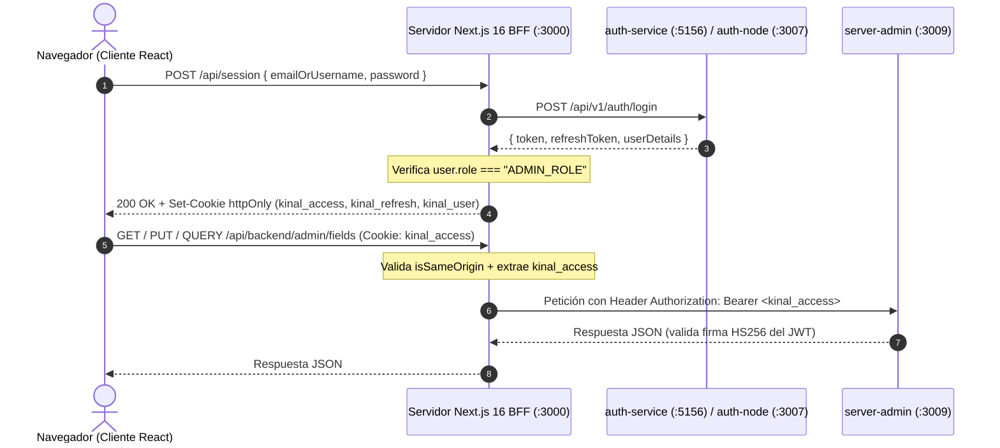

# Client Admin Next — Panel Administrativo BFF (Next.js 16 App Router)

## 1. Propósito del Componente

`client-admin-next` es la implementación del panel administrativo de **KinalSports** construida con **Next.js 16.4 (App Router)**, **React 19**, **TypeScript 6** y **TailwindCSS 4** aplicando el patrón arquitectónico **Backend for Frontend (BFF)**.

Su propósito dentro del monorepo es mostrar cómo una capa BFF en servidor permite aislar por completo al navegador de la topología interna de microservicios: las direcciones reales de `auth-service` / `auth-node` y `server-admin` solo existen en el proceso Node.js de Next.js, y el cliente web se comunica únicamente con rutas del mismo origen (`/api/session` y `/api/backend/...`).

---

## 2. Responsabilidad dentro de KinalSports

- Ofrece todas las capacidades administrativas de la plataforma (gestión de canchas, reservaciones, equipos, torneos y roles de usuario) más una vista de resumen operativo diario en `/dashboard`.
- Actúa como **proxy inverso autenticado y gestor de sesión**:
  - En desarrollo (`docker-compose.yml`), el servidor de Next.js se comunica internamente por la red de Docker con `http://auth-service:5156/api/v1` y `http://server-admin:3009/kinalSportsAdmin/v1`.
  - En producción (`docker-compose.prod.yml`), se comunica con `http://auth-node:3007/api/v1` y `http://server-admin:3009/kinalSportsAdmin/v1` sin requerir recompilar el bundle por cambios de URL.

---

## 3. Stack Tecnológico Verificado

| Categoría                  | Paquete / Versión (`package.json`)                                                      | Uso en la Aplicación                                                                                |
| :------------------------- | :-------------------------------------------------------------------------------------- | :-------------------------------------------------------------------------------------------------- |
| **Framework Full-Stack**   | `next` `^16.4.6` (App Router, Turbopack, `output: 'standalone'`)                        | Renderizado híbrido, Route Handlers (`/api/*`) y middleware `src/proxy.ts`.                         |
| **Librería UI y Lenguaje** | `react` `^19.3.1`, `react-dom` `^19.3.1`, `typescript` `~6.0.3`, `server-only` `^0.0.1` | Componentes de cliente y módulos garantizados exclusivamente en servidor.                           |
| **Estilos**                | `tailwindcss` `^4.3.5`, `@tailwindcss/postcss` `^4.3.5`                                 | Diseño responsivo del panel administrativo.                                                         |
| **Pruebas Unitarias**      | `vitest` `^5.1.0`, `@testing-library/react` `^16.3.3`, `jsdom` `^31.0.1`                | Pruebas unitarias del middleware `proxy.ts`, gestión de cookies BFF, validación de origen y vistas. |

---

## 4. Arquitectura Interna (Backend for Frontend — BFF)



1. **Módulos Exclusivos de Servidor (`src/server/`, protegidos con `import 'server-only'`):**
   - `config.ts`: Lee `AUTH_API_URL` y `ADMIN_API_URL` en tiempo de ejecución del servidor.
   - `session.ts`: Administra las tres cookies `httpOnly` (`kinal_access`, `kinal_refresh` y `kinal_user` con `SameSite=Lax` y `Secure` en producción) e incluye `readAccessTokenRole(accessToken)`, que decodifica el payload `base64url` del JWT para extraer su claim `role`.
   - `origin.ts`: Implementa `isSameOrigin(request)` comparando las cabeceras `Origin` / `Referer` contra el `Host` para bloquear peticiones mutantes (_POST_, _PUT_, _PATCH_, _DELETE_) originadas fuera del sitio (defensa CSRF).
2. **Middleware de Protección de Rutas (`src/proxy.ts`):**
   - Intercepta las navegaciones hacia `/dashboard/*`.
   - Verifica que el usuario posea `ADMIN_ROLE` en `kinal_user` y que, cuando `kinal_access` está presente, el claim `role` dentro del payload del JWT coincida con `kinal_user.role` (evitando escalación de privilegios por manipulación de metadatos).
   - Si `kinal_access` expiró pero existe `kinal_refresh`, invoca `refreshBackendSession` servidor-a-servidor y actualiza las cookies en la misma respuesta antes de renderizar la página.
3. **Route Handlers del BFF (`src/app/api/`):**
   - `api/session/route.ts`: Gestiona `POST` (login exclusivo para `ADMIN_ROLE`), `GET` (lectura de sesión actual con refresco automático) y `DELETE` (revocación de `refreshToken` en el backend y limpieza de cookies).
   - `api/backend/[service]/[...path]/route.ts`: Reenvía peticiones `GET`, `POST`, `PUT`, `PATCH`, `DELETE` y `QUERY` hacia `auth` o `admin`, inyectando `Authorization: Bearer <kinal_access>` (y `x-token`) y reintentando automáticamente una vez tras refrescar el token si el microservicio responde `401` o `403 TOKEN_EXPIRED`.

> **Precisión sobre validación del JWT:** El servidor BFF de Next.js no almacena `JWT_SECRET`; `readAccessTokenRole` verifica la coherencia estructural del claim `role` en la navegación, mientras que la validación criptográfica de la firma `HS256` la ejecutan siempre los microservicios (`auth-service`, `auth-node` y `server-admin`) en cada llamada a la API.

---

## 5. Estructura Principal del Directorio

```text
client-admin-next/
├── src/
│   ├── proxy.ts                                        # Middleware de Next.js 16 para /dashboard/*
│   ├── app/
│   │   ├── page.tsx                                    # Inicio de sesión, registro y recuperación
│   │   ├── verify-email/page.tsx                       # Confirmación de correo electrónico
│   │   ├── reset-password/page.tsx                     # Restablecimiento de contraseña
│   │   ├── unauthorized/page.tsx                       # Pantalla de acceso restringido
│   │   ├── dashboard/                                  # Vistas protegidas: resumen, fields, reservations, teams, tournaments, users
│   │   └── api/
│   │       ├── session/route.ts                        # Gestión de sesión BFF (POST, GET, DELETE)
│   │       └── backend/[service]/[...path]/route.ts    # Proxy HTTP hacia auth y server-admin (incluye método QUERY)
│   ├── server/
│   │   ├── config.ts                                   # Variables de entorno exclusivas del servidor
│   │   ├── session.ts                                  # Manejo de cookies httpOnly y decodificación de rol
│   │   ├── auth-api.ts                                 # Cliente servidor-a-servidor hacia auth (timeout 10 s)
│   │   ├── origin.ts                                   # Protección CSRF Same-Origin
│   │   └── server.test.ts                              # Pruebas unitarias de la capa BFF
│   ├── features/                                       # Componentes por dominio (auth, overview, fields, reservations, teams, tournaments, users)
│   ├── shared/                                         # Cliente HTTP del navegador (/api/*), utilidades y componentes comunes
│   └── test/                                           # Configuración de Vitest
├── .env.example
├── next.config.ts
├── tsconfig.json
└── package.json
```

---

## 6. Requisitos

- **Node.js:** `>= 22.13.0`
- **pnpm:** `>= 10`
- **Backends en ejecución:** `server-admin` (`:3009`) y `auth-service` (`:5156`) o `auth-node` (`:3007`).

---

## 7. Configuración de Variables de Entorno

Copia `.env.example` a `.env.local`:

```bash
cp client-admin-next/.env.example client-admin-next/.env.local
```

Variables verificadas en `src/server/config.ts`:

| Variable                          | Alcance            | Valor de Referencia (Local)                         | Descripción                                                                                           |
| :-------------------------------- | :----------------- | :-------------------------------------------------- | :---------------------------------------------------------------------------------------------------- |
| `AUTH_API_URL`                    | Solo Servidor      | `http://localhost:5156/api/v1`                      | URL base del servicio de autenticación (`http://auth-node:3007/api/v1` en `docker-compose.prod.yml`). |
| `ADMIN_API_URL`                   | Solo Servidor      | `http://localhost:3009/kinalSportsAdmin/v1`         | URL base de `server-admin`.                                                                           |
| `NEXT_PUBLIC_CLOUDINARY_BASE_URL` | Cliente y Servidor | `https://res.cloudinary.com/b3xvlule/image/upload/` | Base pública de Cloudinary para renderizar imágenes guardadas como `public_id`.                       |

---

## 8. Ejecución Local

### Desde la raíz del monorepo

```bash
pnpm --filter @kinal/client-admin-next dev
```

### Desde el directorio del paquete

```bash
cd client-admin-next
pnpm install
pnpm dev
```

### Scripts disponibles en `package.json`

- `pnpm dev`: Inicia `next dev --port 3000`.
- `pnpm build`: Genera la compilación de producción (`next build` con salida `standalone`).
- `pnpm start`: Inicia el servidor de producción (`next start --port 3000`).
- `pnpm typecheck`: Ejecuta `tsc --noEmit`.
- `pnpm lint`: Ejecuta ESLint.
- `pnpm test` / `pnpm test:watch` / `pnpm test:coverage`: Ejecuta las 38 pruebas unitarias con Vitest.

---

## 9. Integraciones y Rutas Expuestas

### Rutas de Interfaz (App Router)

- `/`, `/verify-email`, `/reset-password`, `/unauthorized` (Públicas).
- `/dashboard`, `/dashboard/fields`, `/dashboard/reservations`, `/dashboard/teams`, `/dashboard/tournaments`, `/dashboard/users` (Protegidas para `ADMIN_ROLE` por `src/proxy.ts`).

### Rutas Internas del BFF

- `POST /api/session`, `GET /api/session`, `DELETE /api/session`.
- `GET | POST | PUT | PATCH | DELETE | QUERY /api/backend/auth/[...path]` -> reenviado a `AUTH_API_URL`.
- `GET | POST | PUT | PATCH | DELETE | QUERY /api/backend/admin/[...path]` -> reenviado a `ADMIN_API_URL`.

---

## 10. Pruebas

La suite de pruebas (`src/**/*.test.{ts,tsx}`) se ejecuta con **Vitest**:

```bash
pnpm --filter @kinal/client-admin-next test
```

Valida `proxy.ts` (redirección sin sesión, bloqueo cuando el claim `role` del JWT no coincide con `ADMIN_ROLE` y refresco transparente con `kinal_refresh`), `api/session`, `api/backend` (incluyendo reintento tras `401` y bloqueo CSRF `isSameOrigin`) y los componentes de interfaz.

---

## 11. Build, Despliegue en Docker y Limitaciones Relevantes

### 11.1 Construcción Multi-Etapa en Docker

`next.config.ts` habilita `output: 'standalone'`. El archivo `dockerfiles/Dockerfile.client-admin-next` construye la imagen sobre `node:26-slim`:

- **Etapa `dev`:** Ejecuta `next dev --port 3000 --hostname 0.0.0.0`.
- **Etapa `runtime`:** Copia `.next/standalone`, `.next/static` y `public`, y ejecuta `node server.js` en el puerto `3000` bajo el usuario sin privilegios `node`.

### 11.2 Limitaciones y Consideraciones Operativas

- **La verificación criptográfica del JWT reside en los backends:** El BFF (`src/server/session.ts` y `src/proxy.ts`) decodifica el payload `base64url` de `kinal_access` para validar la coherencia del claim `role` durante la navegación, pero **no verifica criptográficamente la firma `HS256`** ni posee `JWT_SECRET`. Toda autorización efectiva ocurre cuando el proxy BFF reenvía el token hacia `auth-service`, `auth-node` o `server-admin`.
- **Timeout en el proxy BFF:** Las llamadas servidor-a-servidor aplican un timeout de `10 000 ms` (`src/server/auth-api.ts`); cargas multimedia de gran tamaño deben respetar los límites configurados en los microservicios destino.

---

## 12. Documentación Relacionada

- [README Principal del Monorepo](../README.md)
- [Arquitectura Detallada del Sistema](../docs/ARCHITECTURE.md)
- [Client Admin — Implementación SPA equivalente en React + Vite](../client-admin/README.md)
- [Server Admin — API administrativa](../server-admin/README.md)
- [Auth Service (.NET 10)](../authentication-service/auth-service/README.md) y [Auth Node (Fastify)](../authentication-service/auth-node/README.md)
