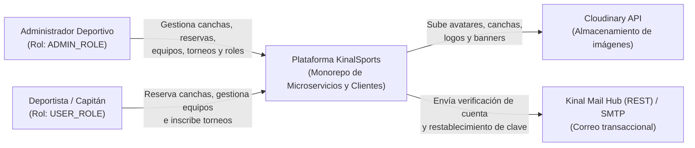
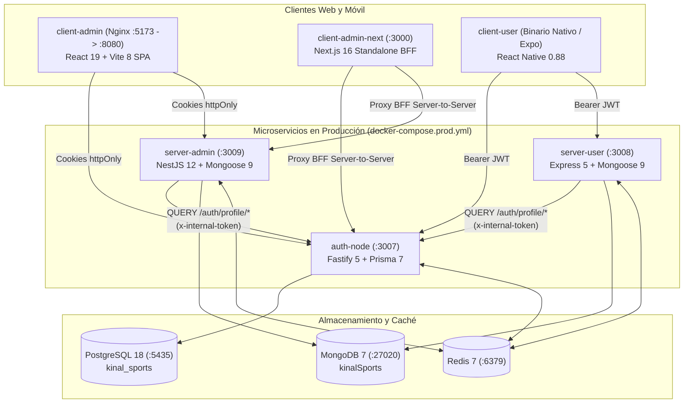
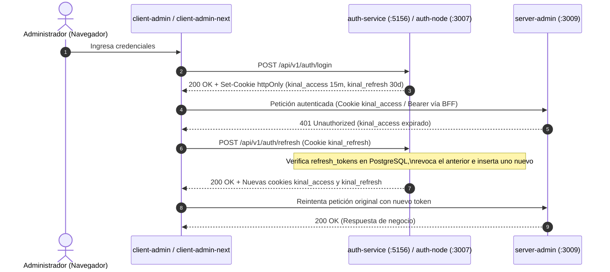

# Arquitectura del Sistema

**KinalSports · Fundación Kinal · 6to. Perito en Computación**

Este documento ofrece la referencia arquitectónica transversal del monorepo **KinalSports**, estructurada bajo principios del **C4 Model** (Contexto, Contenedores, Componentes y Secuencias) y del marco documental **Diátaxis** (sección de Explicación y Referencia Técnica).

---

## Índice de Navegación

1. [Visión Arquitectónica General](#1-visión-arquitectónica-general)
2. [Diagrama de Contexto del Sistema (Nivel C1)](#2-diagrama-de-contexto-del-sistema-nivel-c1)
3. [Diagrama de Contenedores y Topologías de Despliegue (Nivel C2)](#3-diagrama-de-contenedores-y-topologías-de-despliegue-nivel-c2)
4. [Estilos Arquitectónicos Comparados por Servicio (Nivel C3)](#4-estilos-arquitectónicos-comparados-por-servicio-nivel-c3)
5. [Flujos de Autenticación y Seguridad de Sesión](#5-flujos-de-autenticación-y-seguridad-de-sesión)
6. [Modelo de Persistencia Poliglota y Caché Distribuida](#6-modelo-de-persistencia-poliglota-y-caché-distribuida)
7. [Comunicación Interna y Uso del Método HTTP `QUERY`](#7-comunicación-interna-y-uso-del-método-http-query)
8. [Documentación Relacionada](#8-documentación-relacionada)

---

## 1. Visión Arquitectónica General

**KinalSports** está diseñado como un ecosistema de microservicios poliglota que separa el **dominio de identidad y control de acceso** (respaldado en PostgreSQL 18) del **dominio operativo deportivo** (respaldado en MongoDB 7), coordinados mediante una capa de **caché distribuida en Redis 7** y tokens JWT firmados con `HS256`.

Esta arquitectura cumple dos propósitos simultáneos:

1. **Propósito técnico:** Garantizar desacoplamiento entre operaciones administrativas (`server-admin`) y operaciones de autoservicio de los deportistas (`server-user`), permitiendo incluso conmutar el motor de autenticación entre `.NET 10` y `Node.js` sin alterar los clientes ni migrar datos.
2. **Propósito formativo:** Permitir a los estudiantes de **6to. Perito en Computación** contrastar en un mismo repositorio seis patrones arquitectónicos reales (_Clean Architecture_, _Arquitectura Hexagonal_, _Arquitectura Modular_, _Arquitectura por Capas_, _SPA_ y _Backend for Frontend_).

---

## 2. Diagrama de Contexto del Sistema (Nivel C1)

---

## 3. Diagrama de Contenedores y Topologías de Despliegue (Nivel C2)

El monorepo soporta dos topologías de ejecución definidas en `docker-compose.yml` (Desarrollo) y `docker-compose.prod.yml` (Producción):

### 3.1 Topología de Desarrollo y Formación

En desarrollo (`docker-compose.yml`) se ejecutan simultáneamente `auth-service` (`.NET 10`, `:5156`) y `auth-node` (`Fastify`, `:3007`) tras la inicialización del contenedor efímero `auth-migrator`. El stack administrativo consume `auth-service` y el stack móvil/usuario consume `auth-node`.

### 3.2 Topología de Producción

En producción (`docker-compose.prod.yml`) se despliega una arquitectura **100% Node.js** donde `auth-node` (`:3007`) inicializa de forma idempotente el esquema SQL canónico en PostgreSQL 18 y atiende tanto a los paneles administrativos (`client-admin`, `client-admin-next`, `server-admin`) como al ecosistema de usuarios (`server-user`, `client-user`).

---

## 4. Estilos Arquitectónicos Comparados por Servicio (Nivel C3)

### 4.1 Servicios de Autenticación (`auth-service` vs. `auth-node`)

| Dimensión                     | `auth-service` (ASP.NET Core 10)                                                                                   | `auth-node` (Fastify 5 + TypeScript 6)                                                                                                  |
| :---------------------------- | :----------------------------------------------------------------------------------------------------------------- | :-------------------------------------------------------------------------------------------------------------------------------------- |
| **Patrón Arquitectónico**     | **Clean Architecture** en 5 proyectos `.csproj` (`Domain`, `Application`, `Infrastructure`, `Persistence`, `Api`). | **Arquitectura Hexagonal (Puertos y Adaptadores)** organizada por módulos (`auth`, `users`, `roles`) e inyectada en `src/container.ts`. |
| **Acceso a Datos**            | Entity Framework Core 10 (`ApplicationDbContext`) con `UseSnakeCaseNamingConvention()`.                            | Prisma 7 (`@prisma/adapter-pg`) e inicialización SQL idempotente (`CANONICAL_SCHEMA_SQL`).                                              |
| **Inyección de Dependencias** | Contenedor nativo `IServiceCollection` de ASP.NET Core (`AddApplication`, `AddInfrastructure`, `AddPersistence`).  | Inyección funcional explícita mediante fábricas (`makeLogin`, `makeRegisterUser`, etc.) sin decoradores de framework en casos de uso.   |
| **Pruebas Unitarias**         | xUnit v3 (`4.0.3`) + NSubstitute (`6.2.0`).                                                                        | Vitest 5 con dobles de prueba en memoria (`src/test/fakes.ts`).                                                                         |

### 4.2 Servicios de Negocio (`server-admin` vs. `server-user`)

| Dimensión                       | `server-admin` (NestJS 12 + TypeScript 6)                                                                                                          | `server-user` (Express 5 ESM)                                                                                                              |
| :------------------------------ | :------------------------------------------------------------------------------------------------------------------------------------------------- | :----------------------------------------------------------------------------------------------------------------------------------------- |
| **Patrón Arquitectónico**       | **Arquitectura Modular** orientada a decoradores (`@Module`, `@Controller`, `@Injectable`, `Guards`, `Pipes`, `Interceptors`, `ExceptionFilters`). | **Arquitectura por Capas** explícita (`*.routes.js` -> `*.controller.js` -> `*.service.js` -> `*.repository.js` + `*.model.js`).           |
| **Validación de Entradas**      | Esquemas Zod + `ValidateRequestInterceptor` + `ObjectIdPipe`.                                                                                      | `express-validator` + validación de reglas de dominio en `*.service.js` + normalización de `CastError` a `400 INVALID_ID`.                 |
| **Acceso a Canchas (`fields`)** | Fuente primaria de escritura (`POST`, `PUT`, `activate`, `deactivate`) e invalidación del prefijo `kinal:fields:` en Redis.                        | Consulta directamente la colección `fields` en el **MongoDB compartido** y lee/escribe claves `kinal:fields:*` en el **Redis compartido**. |

### 4.3 Clientes Administrativos (`client-admin` SPA vs. `client-admin-next` BFF)

| Dimensión                 | `client-admin` (React 19 + Vite 8)                                                                             | `client-admin-next` (Next.js 16 App Router)                                                                                                                                |
| :------------------------ | :------------------------------------------------------------------------------------------------------------- | :------------------------------------------------------------------------------------------------------------------------------------------------------------------------- |
| **Patrón Arquitectónico** | **Single Page Application (SPA)** dividida por _features_.                                                     | **Backend for Frontend (BFF)** con Route Handlers (`/api/session`, `/api/backend/...`) y middleware `src/proxy.ts`.                                                        |
| **Topología de Red**      | El navegador realiza peticiones CORS con `withCredentials: true` hacia los puertos de `auth` y `server-admin`. | El navegador solo se comunica con su propio origen (`/api/*`); el servidor Node.js de Next.js contacta internamente a los microservicios.                                  |
| **Verificación de JWT**   | Los backends verifican criptográficamente la cookie `httpOnly` `kinal_access` en cada petición.                | `src/proxy.ts` valida la coherencia del claim `role` en la navegación y **los backends verifican criptográficamente la firma `HS256` del JWT** en cada petición reenviada. |

---

## 5. Flujos de Autenticación y Seguridad de Sesión

### 5.1 Flujo Web con Cookies `httpOnly` y Renovación Concurrente

### 5.2 Flujo Móvil con `expo-secure-store` (`client-user`)

1. Al iniciar sesión contra `POST /api/v1/auth/login` en `auth-node` (`:3007`), `client-user` recibe `{ token, refreshToken, userDetails }` en el cuerpo JSON y los almacena cifrados en `expo-secure-store`.
2. Cada petición hacia `server-user` (`:3008`) adjunta `Authorization: Bearer <token>`.
3. Cuando `server-user` responde `401`, `src/shared/api/tokenRefresh.js` sincroniza las peticiones concurrentes en una sola llamada a `POST /api/v1/auth/refresh`, persiste el nuevo par de tokens en `expo-secure-store` y reintenta la operación.

---

## 6. Modelo de Persistencia Poliglota y Caché Distribuida

### 6.1 Base de Datos Relacional: PostgreSQL 18 (`kinal_sports`)

Compartida por `auth-service` y `auth-node` con convención `snake_case`:

- `users`: Identificador (`varchar(16)` con prefijo `usr_`), `name`, `surname`, `username` (único), `email` (único), `password` (hash Argon2id), `status`, marcas de tiempo.
- `user_profiles`: `id`, `user_id` (FK única), `profile_picture`, `phone` (8 dígitos).
- `roles` y `user_roles`: Asignación de `ADMIN_ROLE` y `USER_ROLE`.
- `user_emails`: Estado `email_verified`, `email_verification_token` y expiración.
- `user_password_resets`: `password_reset_token` y expiración.
- `refresh_tokens`: `id`, `user_id` (FK con borrado en cascada), `token` (hash/valor único), `expires_at`, `revoked_at`, `replaced_by_token`, `created_at`.

### 6.2 Base de Datos Documental: MongoDB 7 (`kinalSports`)

Compartida por `server-admin` y `server-user`:

- `fields`: `fieldName`, `fieldType`, `capacity`, `pricePerHour`, `description`, `location`, `image`, `isActive`.
- `reservations`: `fieldId` (ref `Field`), `userId` (ID de PostgreSQL), `startTime`, `endTime`, `totalPrice`, `status` (`PENDING`, `CONFIRMED`, `CANCELLED`, `COMPLETED`), `notes`, `cancellationReason`, `cancelledBy`.
- `teams`: `name`, `description`, `category` (`FUTBOL_5`, `FUTBOL_7`, `FUTBOL_11`), `managerId` (capitán), `members` (array de `userId`), `namedMembers` (subdocumentos invitados), `logo`, `isActive`.
- `tournaments`: `name`, `description`, `category`, `startDate`, `endDate`, `maxTeams`, `teams` (array de `ObjectId` ref `Team`), `registrationFee`, `prize`, `status` (`PENDIENTE`, `EN_CURSO`, `FINALIZADO`, `CANCELADO`), `image`, `isActive`.

### 6.3 Estrategia de Caché Distribuida en Redis 7 (`Cache-Aside`)

Los cuatro microservicios implementan un cliente TCP sobre protocolo `RESP2` con degradación automática a memoria local si `REDIS_URL` no está definido o si Redis no responde:

| Prefijo de Clave en Redis     | TTL     | Productores / Lectores                                                                                                    | Eventos de Invalidación                                                                                                                           |
| :---------------------------- | :------ | :------------------------------------------------------------------------------------------------------------------------ | :------------------------------------------------------------------------------------------------------------------------------------------------ |
| `kinal:fields:<hash-filtros>` | `120 s` | Leído y escrito por `server-admin` y `server-user` en `GET /fields` y `QUERY /fields`.                                    | `server-admin` ejecuta `delByPrefix('kinal:fields:')` al crear, editar, activar o desactivar una cancha.                                          |
| `kinal:user:profile:<userId>` | `60 s`  | Leído y escrito por `auth-node`, `auth-service`, `server-admin` (`AuthClientService`) y `server-user` (`auth.client.js`). | `auth-node`, `auth-service` y `server-user` invalidan la clave al actualizar fotografía de perfil, verificar correo o cambiar el rol del usuario. |

---

## 7. Comunicación Interna y Uso del Método HTTP `QUERY`

El monorepo utiliza el método HTTP `QUERY` (definido por IETF HTTPbis como método seguro e idempotente con cuerpo de solicitud) en dos escenarios concretos:

1. **Resolución interna de perfiles entre microservicios:**
   - `server-admin` y `server-user` invocan `QUERY /api/v1/auth/profile/by-id` (`{ "userId": "usr_..." }`) y `QUERY /api/v1/auth/profile/by-username` (`{ "username": "..." }`) autenticándose con la cabecera `x-internal-token`.
   - Tanto `auth-node` como `auth-service` mantienen `POST` en las mismas rutas como alias de compatibilidad.
2. **Filtrado estructurado de canchas:**
   - `QUERY /kinalSportsAdmin/v1/fields` (`server-admin`), `QUERY /kinalSportsUser/v1/fields` (`server-user`) y el proxy BFF `/api/backend/admin/fields` (`client-admin-next`) permiten enviar filtros tipados en el cuerpo JSON sin exponer cadenas de consulta extensas en la URL.

---

## 8. Documentación Relacionada

- [README Principal del Monorepo](../README.md)
- [Guía de Desarrollo, Operación y Solución de Problemas](./DEVELOPMENT_AND_OPERATIONS.md)
- [Política de Seguridad](../SECURITY.md)
- [Pruebas de Contrato HTTP](../tests/contract/README.md)
